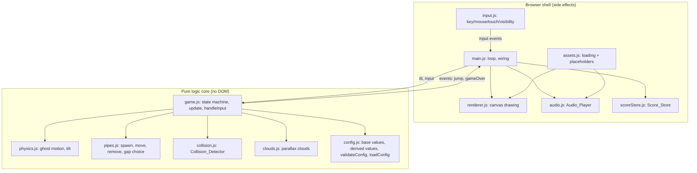
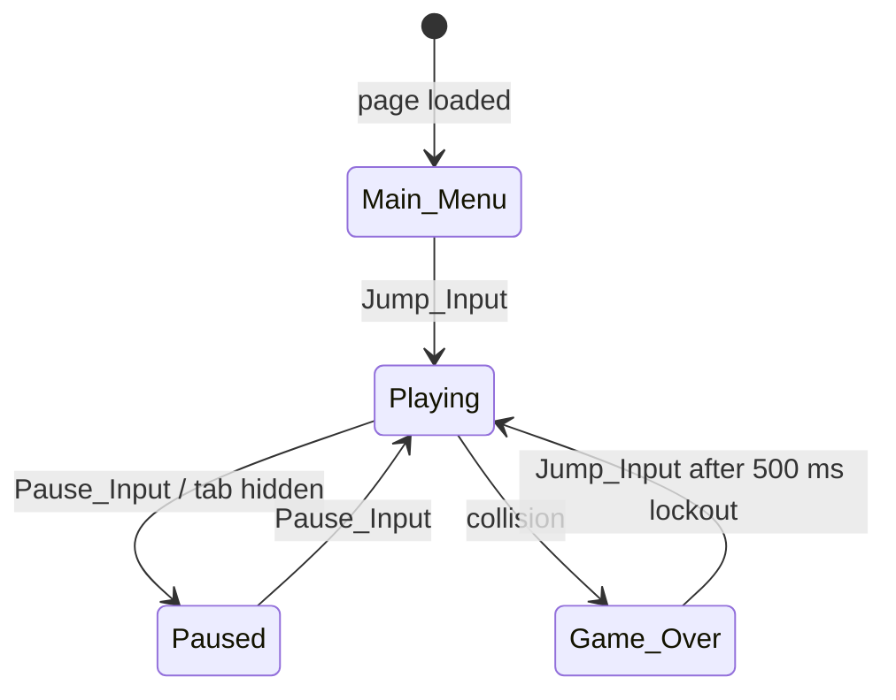
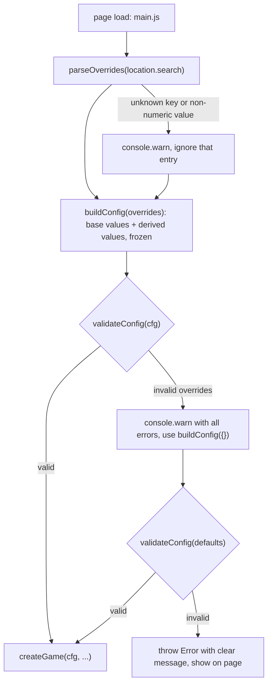
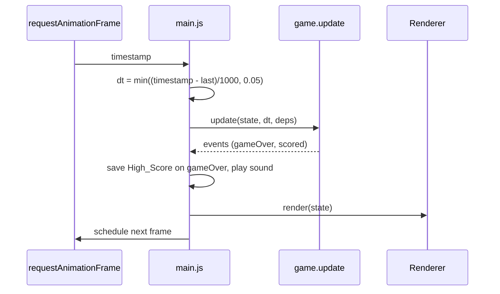

# Design Document: Flappy Kiro

## Overview

Flappy Kiro is a static, browser-based endless scroller built with an HTML canvas and vanilla JavaScript. There is no server-side component, no build step and no runtime dependency. The player steers Ghosty through gaps in an endless series of Pipe_Pairs. The game has four Game_States (Main_Menu, Playing, Paused, Game_Over), persists the High_Score in local storage, and uses the three existing assets: `assets/ghosty.png`, `assets/jump.wav` and `assets/game_over.wav`.

### Research Summary

Key findings that shape the design:

- **Fixed logical resolution with CSS scaling.** Drawing to a 480 by 640 canvas and scaling it with CSS (`image-rendering: pixelated`, `ctx.imageSmoothingEnabled = false`) keeps pixel edges sharp and preserves the aspect ratio. See [MDN: Crisp pixel art look](https://developer.mozilla.org/en-US/docs/Games/Techniques/Crisp_pixel_art_look) and [MDN: imageSmoothingEnabled](https://developer.mozilla.org/en-US/docs/Web/API/CanvasRenderingContext2D/imageSmoothingEnabled).
- **Time-based loop.** `requestAnimationFrame` passes a high-resolution timestamp. Using the delta between timestamps, clamped to 50 ms, gives refresh-rate independent gameplay and avoids a large jump after a tab was hidden. See [MDN: requestAnimationFrame](https://developer.mozilla.org/en-US/docs/Web/API/window/requestAnimationFrame).
- **Page Visibility.** The `visibilitychange` event on `document` together with `document.visibilityState` lets the game auto-pause. See [MDN: Page Visibility API](https://developer.mozilla.org/en-US/docs/Web/API/Page_Visibility_API).
- **Audio.** `HTMLAudioElement.play()` returns a promise that rejects when autoplay is blocked. The rejection must be caught so the game keeps running. Setting `currentTime = 0` before `play()` restarts a sound that is still playing. See [MDN: HTMLMediaElement.play()](https://developer.mozilla.org/en-US/docs/Web/API/HTMLMediaElement/play).
- **Storage.** `localStorage` access can throw (private mode, disabled storage), so every read and write sits in a try/catch. See [MDN: Web Storage API](https://developer.mozilla.org/en-US/docs/Web/API/Web_Storage_API).
- **Pixel font.** A pixel-style font is drawn with a generic fallback (`"Press Start 2P", monospace`). No network font is required, so the game still works offline; the monospace fallback is acceptable.
- **Loading from `file://`.** Browsers block ES module scripts on `file://` origins. To keep "static files, no server" true even when `index.html` is opened by double-click, the code uses classic `<script>` tags and a single global namespace (`FlappyKiro`). Logic modules also export through `module.exports` when it exists, so they can be tested in Node.

- **Query parameters.** `URLSearchParams` parses `location.search` without a server and works from `file://`. Values arrive as strings, so each override is converted with `Number()` and rejected unless it is finite. See [MDN: URLSearchParams](https://developer.mozilla.org/en-US/docs/Web/API/URLSearchParams).
- **Deep freeze.** `Object.freeze` is shallow, so each config group is frozen separately. See [MDN: Object.freeze()](https://developer.mozilla.org/en-US/docs/Web/JavaScript/Reference/Global_Objects/Object/freeze).

Content was rephrased for compliance with licensing restrictions.

### Design Decisions

| Decision | Rationale |
|---|---|
| Split pure game logic from the browser shell | Collision, physics, spawning, scoring, state transitions and score storage become deterministic functions that can be property-tested in Node without a DOM. |
| Single mutable `GameState` object, updated by `update(state, dt, deps)` and `handleInput(state, input, deps)` | Simple for a small game; one place holds every value the requirements freeze while paused. |
| Injected `rng` and `clock` dependencies | Makes gap generation and timers reproducible in tests. |
| Y axis grows downward; upward velocity is negative | Matches canvas coordinates. Gravity is +1800, jump velocity is -520. |
| Timers (invincibility, crash, lockout) count down using the clamped `dt` of Playing/Game_Over updates | Pausing freezes them for free because no update runs, and hidden time is never counted. |
| `Pipe_Pair.x` is the left edge of the widest element (the 72 wide cap); the 64 wide body is inset by 4 | Gives one unambiguous left edge for spawning and one right edge (`x + 72`) for scoring and removal. |
| Classic scripts plus a global namespace | Works from `file://` with no server. |
| One frozen config, grouped by area, with derived values computed in code | Base values are the only numbers a person edits. `GROUND_TOP`, the gap center range and similar values are computed, so they cannot drift out of sync. |
| Core functions take the config in use (`cfg`) as an argument instead of reading a global | Tests can run the same logic against the default config and against generated variations. |
| Validation at startup, with a whitelist for URL overrides | A bad value fails with a clear message (or falls back to defaults for URL overrides) instead of producing an unplayable game. |
| Cloud speed bounds are validated as `min < max`, not only `min <= max` | Requirement 13.3 needs at least two distinct cloud speeds, which an equal min and max cannot give. |

## Architecture

The game is split into a pure logic core and a thin browser shell. The shell reads input and time, calls the core, and then draws and plays sounds based on the core's state and emitted events.



### Game State Machine

Only five transitions are permitted (Requirement 15).



### Startup and Config Flow



### Frame Flow



### File Layout

```
index.html            canvas, pause and mute controls, script tags
src/config.js         base values, derived values, validateConfig, parseOverrides, loadConfig
src/physics.js        ghost motion and tilt
src/pipes.js          pipe spawning, movement, gap selection, speed curve
src/collision.js      hitboxes and overlap tests
src/clouds.js         cloud creation, movement and wrap
src/game.js           GameState, update, handleInput, transitions
src/scoreStore.js     High_Score persistence
src/audio.js          Audio_Player with mute
src/assets.js         asset loading with fallbacks
src/renderer.js       canvas drawing
src/input.js          input mapping
src/main.js           loop and wiring
tests/*.test.js       unit and property tests
```

## Components and Interfaces

### config.js

One plain file holds every tunable number, grouped by area, with units and a short comment. No other module contains a magic number. The file is a classic script: it attaches to `FlappyKiro` in the browser and also sets `module.exports` when it exists, so it works from `file://` and in Node.

Only base values are written by hand. Derived values are computed by `buildConfig` from the base values, so they cannot drift out of sync. Every group is frozen, and `buildConfig` returns a frozen object.

```js
// src/config.js (classic script; units: px = logical pixels, s = seconds, ms = milliseconds)
(function (root) {
  const DEFAULT_BASE = {
    world:  {
      WIDTH: 480,              // px, logical canvas width
      HEIGHT: 640,             // px, logical canvas height
      GROUND_HEIGHT: 80,       // px, height of the ground strip
    },
    ghost:  {
      SPRITE_SIZE: 48,         // px, drawn sprite is SPRITE_SIZE x SPRITE_SIZE
      HITBOX_SIZE: 32,         // px, collision square centered on the sprite
      X: 120,                  // px, horizontal center of the ghost
      GRAVITY: 1800,           // px/s^2, downward acceleration
      JUMP_SPEED: 520,         // px/s, upward speed set by a jump
    },
    pipes:  {
      PIPE_WIDTH: 64,          // px, pipe body width
      CAP_WIDTH: 72,           // px, pipe cap width
      CAP_HEIGHT: 24,          // px, pipe cap height
      GAP_HEIGHT: 160,         // px, vertical opening
      GAP_MARGIN: 60,          // px, minimum distance from gap to ceiling and to ground
      PIPE_SPACING: 280,       // px, distance between left edges of consecutive pairs
      MAX_GAP_SHIFT: 200,      // px, max change of gap center between consecutive pairs
    },
    speed:  {
      INITIAL_SPEED: 150,      // px/s, scroll speed at round start
      SPEED_INCREMENT: 10,     // px/s added per speed step
      SPEED_STEP_INTERVAL: 5,  // points per speed step (positive integer)
      MAX_SPEED: 240,          // px/s, upper limit of scroll speed
    },
    timing: {
      INVINCIBILITY_MS: 1500,  // ms, pipe-collision immunity after a round starts
      CRASH_MS: 500,           // ms, crash animation length
      CRASH_FLASH_MS: 100,     // ms, flash interval during the crash animation
      BLINK_MS: 100,           // ms, blink interval during invincibility
      LOCKOUT_MS: 500,         // ms, jump lockout after game over
      MAX_FRAME_MS: 50,        // ms, cap on a single update step
    },
    clouds: {
      SPEED_MIN: 10,           // px/s, speed of the farthest (smallest) cloud
      SPEED_MAX: 60,           // px/s, speed of the nearest (largest) cloud
      LAYERS: [                // width in px; depth 0..1 maps linearly onto SPEED_MIN..SPEED_MAX
        { WIDTH: 40,  DEPTH: 0.1, ALPHA: 0.5 },
        { WIDTH: 80,  DEPTH: 0.5, ALPHA: 0.6 },
        { WIDTH: 120, DEPTH: 0.9, ALPHA: 0.7 },
      ],
    },
  };

  // Derived values: computed only here, never edited by hand, never overridable.
  function derive(b) {
    const GROUND_TOP = b.world.HEIGHT - b.world.GROUND_HEIGHT;
    return {
      world:  { GROUND_TOP, MENU_GHOST_Y: b.world.HEIGHT / 2 },
      ghost:  { HITBOX_INSET: (b.ghost.SPRITE_SIZE - b.ghost.HITBOX_SIZE) / 2,
                JUMP_VELOCITY: -b.ghost.JUMP_SPEED },          // y grows downward
      pipes:  { CAP_INSET: (b.pipes.CAP_WIDTH - b.pipes.PIPE_WIDTH) / 2,
                GAP_CENTER_MIN: b.pipes.GAP_MARGIN + b.pipes.GAP_HEIGHT / 2,
                GAP_CENTER_MAX: GROUND_TOP - b.pipes.GAP_MARGIN - b.pipes.GAP_HEIGHT / 2,
                SPAWN_X: b.world.WIDTH - b.pipes.PIPE_SPACING },
      timing: { MAX_DT: b.timing.MAX_FRAME_MS / 1000 },         // s
      clouds: { LAYER_SPEEDS: b.clouds.LAYERS.map(l =>
                  b.clouds.SPEED_MIN + l.DEPTH * (b.clouds.SPEED_MAX - b.clouds.SPEED_MIN)) },
    };
  }

  // Tunable keys exposed to ?name=value overrides. Anything not listed here is not overridable.
  const TUNABLE = Object.freeze({
    gravity:          ['ghost',  'GRAVITY'],
    jumpSpeed:        ['ghost',  'JUMP_SPEED'],
    gapHeight:        ['pipes',  'GAP_HEIGHT'],
    gapMargin:        ['pipes',  'GAP_MARGIN'],
    pipeSpacing:      ['pipes',  'PIPE_SPACING'],
    maxGapShift:      ['pipes',  'MAX_GAP_SHIFT'],
    initialSpeed:     ['speed',  'INITIAL_SPEED'],
    speedIncrement:   ['speed',  'SPEED_INCREMENT'],
    speedStepInterval:['speed',  'SPEED_STEP_INTERVAL'],
    maxSpeed:         ['speed',  'MAX_SPEED'],
    invincibilityMs:  ['timing', 'INVINCIBILITY_MS'],
    crashMs:          ['timing', 'CRASH_MS'],
    lockoutMs:        ['timing', 'LOCKOUT_MS'],
    cloudSpeedMin:    ['clouds', 'SPEED_MIN'],
    cloudSpeedMax:    ['clouds', 'SPEED_MAX'],
  });

  // buildConfig(overrides?) -> frozen { world, ghost, pipes, speed, timing, clouds } (base + derived)
  // validateConfig(cfg)     -> { valid: boolean, errors: string[] }
  // parseOverrides(search)  -> { overrides: { [group]: { [KEY]: number } }, warnings: string[] }
  // loadConfig(search, log) -> frozen config; never returns an invalid config (see below)
  // DEFAULT_CONFIG         = buildConfig({})
})(typeof window !== 'undefined' ? (window.FlappyKiro = window.FlappyKiro || {}) : module.exports);
```

Modules refer to values as `cfg.ghost.GRAVITY`, `cfg.pipes.GAP_CENTER_MIN` and so on. The rest of this document uses the bare key names (`GRAVITY`, `GAP_HEIGHT`, `GROUND_TOP`) for brevity.

#### validateConfig

`validateConfig(cfg)` collects every violated rule instead of stopping at the first, so one message lists all problems. Each error string starts with a stable rule id followed by a plain explanation, for example `gap.heightVsHitbox: GAP_HEIGHT (30) must be greater than HITBOX_SIZE (32)`.

| Rule id | Relationship that must hold | Requirement |
|---|---|---|
| `number.finite` | Every numeric base value is a finite number; all sizes, speeds, durations and `SPEED_STEP_INTERVAL` are greater than 0; `SPEED_STEP_INTERVAL` is an integer; `SPEED_INCREMENT >= 0`; `GAP_MARGIN >= 0` | all |
| `ghost.hitboxFits` | `HITBOX_SIZE <= SPRITE_SIZE` | 6.1 |
| `ghost.insideWorld` | `0 < X < WIDTH` | 3.4 |
| `pipes.capCoversBody` | `CAP_WIDTH >= PIPE_WIDTH` | 6.2 |
| `pipes.spacing` | `PIPE_SPACING > CAP_WIDTH` | 4.2 |
| `gap.heightVsHitbox` | `GAP_HEIGHT > HITBOX_SIZE` | 4.4 |
| `gap.fitsAboveGround` | `2 * GAP_MARGIN + GAP_HEIGHT <= GROUND_TOP`, equivalent to `GAP_CENTER_MIN <= GAP_CENTER_MAX` | 4.5 |
| `gap.shiftPositive` | `MAX_GAP_SHIFT > 0` | 4.6 |
| `speed.order` | `INITIAL_SPEED <= MAX_SPEED` | 4.9, 4.10 |
| `reach.fall` | Fall time for `MAX_GAP_SHIFT`: `sqrt(2 * MAX_GAP_SHIFT / GRAVITY) < PIPE_SPACING / MAX_SPEED` | 4.7 |
| `reach.climb` | Climb time for `MAX_GAP_SHIFT` with back-to-back jumps: `ceil(MAX_GAP_SHIFT / h) * (JUMP_SPEED / GRAVITY) < PIPE_SPACING / MAX_SPEED`, where `h = JUMP_SPEED^2 / (2 * GRAVITY)` is the rise of one jump | 4.7 |
| `clouds.order` | `SPEED_MIN < SPEED_MAX` (stricter than `<=` so that two distinct speeds exist) and `SPEED_MIN > 0` | 13.3, 13.5 |
| `clouds.belowScroll` | `SPEED_MAX < INITIAL_SPEED`, so every cloud speed is below the scroll speed at all times | 13.5 |
| `clouds.layers` | At least two layers; every `DEPTH` in [0, 1]; layer depths are distinct and increase with `WIDTH`; every `ALPHA` in (0, 1) | 13.2, 13.3, 13.4 |
| `timing.positive` | `INVINCIBILITY_MS`, `CRASH_MS`, `CRASH_FLASH_MS`, `BLINK_MS`, `LOCKOUT_MS` and `MAX_FRAME_MS` are all greater than 0 | 7.2, 7.7, 7.8, 8.1, 12.5 |

With the defaults, `h` is about 75 px, `ceil(200 / 75)` is 3, the climb time is about 0.87 s, the fall time is about 0.47 s, and the limit `280 / 240` is about 1.17 s, so both reachability rules pass. The climb estimate is a deliberate upper bound: it assumes each jump is taken at the apex of the previous one.

`assertValidConfig(cfg)` calls `validateConfig` and throws `Error('Invalid Flappy Kiro config:\n - ' + errors.join('\n - '))` when `valid` is false.

#### URL overrides

`parseOverrides(search)` reads `new URLSearchParams(search)` and, for each entry:

- If the name is not a key of `TUNABLE`, it adds a warning (`unknown parameter "foo"`) and ignores the entry.
- If the value is empty, or `Number(value)` is not finite, it adds a warning (`parameter "gravity" must be a number, got "abc"`) and ignores the entry.
- Otherwise it stores the number under the mapped group and key. Values are not rounded or clamped here; range and relationship checks belong to `validateConfig`.

If a name appears more than once, the last value wins.

`loadConfig(search, log)` runs the startup flow shown in the Startup and Config Flow diagram:

1. `parseOverrides` and `buildConfig(overrides)`.
2. If `validateConfig` accepts the result, return it. Warnings from step 1 go to `log.warn`.
3. Otherwise `log.warn` reports all errors and that the defaults are used, and the function returns `DEFAULT_CONFIG`.
4. `DEFAULT_CONFIG` itself is checked with `assertValidConfig` when the module loads. If someone edits a base value into an invalid combination, the page fails at startup with the error list instead of running a broken game.

### physics.js

```js
// Every core function takes the config in use (cfg) as its first argument.
// Applies gravity for dt seconds (semi-implicit Euler). x is constant.
function stepGhost(cfg, ghost, dt)     // -> { y, vy }  (vy' = vy + GRAVITY*dt; y' = y + vy'*dt)
function applyJump(cfg, ghost)         // -> { y, vy: JUMP_VELOCITY }
function tiltFor(vy)                   // -> radians; < 0 when vy < 0, 0 when vy === 0, > 0 when vy > 0
function clampDt(cfg, rawSeconds)      // -> min(max(raw, 0), MAX_DT)
```

### pipes.js

```js
// Pipe_Pair: { x, gapCenter, scored }   x = left edge of the 72 wide cap
function gapCenterRange(cfg, prevCenter)    // -> [min, max] for the next gap center
function chooseGapCenter(cfg, prevCenter, rng) // uniform over gapCenterRange
function speedForScore(cfg, score)     // min(MAX_SPEED, INITIAL_SPEED + SPEED_INCREMENT * floor(score / SPEED_STEP_INTERVAL))
function spawnPair(cfg, pairs, rng)    // appends a pair at x = WIDTH
function shouldSpawn(cfg, pairs)       // true when last.x <= SPAWN_X (WIDTH - PIPE_SPACING)
function movePairs(pairs, speed, dt)   // x -= speed * dt
function removeOffscreen(cfg, pairs)   // drops pairs with x + CAP_WIDTH < 0
function pipeRects(cfg, pair)          // -> [topBody, topCap, bottomBody, bottomCap]
```

Gap center bounds. A gap spans `center ± GAP_HEIGHT / 2`. With a margin of `GAP_MARGIN` to the Ceiling and to the Ground (top edge at `GROUND_TOP`), the center lies in `[GAP_CENTER_MIN, GAP_CENTER_MAX]`, where `GAP_CENTER_MIN = GAP_MARGIN + GAP_HEIGHT / 2` and `GAP_CENTER_MAX = GROUND_TOP - GAP_MARGIN - GAP_HEIGHT / 2`. For a non-first pair the range is intersected with `[prev - MAX_GAP_SHIFT, prev + MAX_GAP_SHIFT]`. The intersection is never empty because `prev` itself is always in `[GAP_CENTER_MIN, GAP_CENTER_MAX]`, and `validateConfig` guarantees that interval is not empty (`gap.fitsAboveGround`). With the defaults the range is [140, 420].

Reachability (Requirement 4.7) is no longer a fixed claim about the defaults. `validateConfig` checks it for whatever config is in use, using the `reach.fall` and `reach.climb` rules from the table above. A single jump rises `JUMP_SPEED² / (2 * GRAVITY)` (about 75 px with the defaults).

### collision.js (Collision_Detector)

```js
function ghostHitbox(cfg, ghost)       // HITBOX_SIZE square centered on the sprite center (HITBOX_INSET on each side)
function overlapArea(a, b)             // width*height of the intersection, 0 when only touching
function hitsPipe(cfg, ghost, pairs)   // any hitbox overlap area > 0
function hitsGround(cfg, ghost)        // hitbox bottom >= GROUND_TOP
function hitsCeiling(cfg, ghost)       // hitbox top <= 0
function detect(cfg, ghost, pairs, invincible) // -> { pipe, ground, ceiling } booleans
```

`detect` skips the pipe test when `invincible` is true but always evaluates ground and ceiling.

### clouds.js

```js
// Cloud: { x, y, width, speed, alpha }
function createClouds(cfg, rng)        // one cloud per LAYERS entry (several per layer allowed)
function moveClouds(cfg, clouds, dt)   // x -= speed * dt; wrap to WIDTH when x + width < 0, y unchanged
```

Cloud speeds come from the derived `LAYER_SPEEDS`, which maps each layer depth linearly onto `[SPEED_MIN, SPEED_MAX]`. Because `clouds.layers` requires depth to increase with width, smaller clouds are slower by construction. With the defaults the speeds are 15, 35 and 55.

### game.js

```js
function createGame(cfg, highScore, rng) // -> GameState in Main_Menu
function handleInput(state, input, deps) // input: 'jump' | 'pause' | 'visibilityHidden'
function update(state, dt, deps)       // dt already clamped; returns array of events
function startRound(state, rng)        // resets round values, starts invincibility, applies jump
```

`deps` is `{ cfg, rng }`; `createGame` also stores `cfg` on the state so `startRound` uses the same config. `update` returns events such as `{ type: 'scored' }` and `{ type: 'gameOver', score, previousHighScore }`. Input handling returns `{ type: 'jump' }` when a jump sound should play. The shell owns audio and storage; the core stays pure.

Update order while Playing:

1. Decrement the invincibility timer.
2. Step the ghost physics.
3. Move pipes and ground at the current speed, move clouds, remove off-screen pairs, spawn if needed.
4. Score pairs whose right edge the ghost center has passed; recompute speed from the new score.
5. Run collision detection; on a hit change to Game_Over, end invincibility, start the crash timer and the lockout, and emit `gameOver`.

While Game_Over, `update` only advances the crash animation: the ghost falls under gravity until its hitbox bottom reaches the ground boundary, timers count down, and world positions stay unchanged. While Main_Menu or Paused, `update` changes nothing.

### scoreStore.js (Score_Store)

```js
function parseHighScore(raw)           // string|null -> non-negative integer, else 0
function load(storage)                 // try/catch around storage.getItem
function save(storage, score)          // try/catch around storage.setItem
function recordIfHigher(storage, score, stored) // saves and returns new high score only if score > stored
```

### audio.js (Audio_Player)

```js
function createAudioPlayer(jumpEl, overEl)
// play(name): if muted, return; otherwise element.currentTime = 0; element.play().catch(() => {})
// toggleMute(), isMuted()
```

A missing element (failed asset) makes `play` a no-op.

### assets.js

Loads each asset independently. A failure replaces only that asset: the sprite falls back to a drawn square placeholder, and a failed sound becomes silence. Other assets are unaffected.

### input.js

- `keydown` for Space → `jump` (calls `preventDefault`), P or Escape → `pause`, M → mute. Events with `event.repeat === true` are ignored.
- `mousedown` and `touchstart` on the canvas → `jump`.
- On-screen pause and mute buttons are DOM buttons wired to the same handlers.
- `document.visibilitychange` with `hidden` → `visibilityHidden` (treated as a pause when Playing). On becoming visible the loop resets its `last` timestamp so the hidden duration is never applied.

### renderer.js

Draws in this order: sky background, clouds (alpha between 0 and 1), pipes with caps, ground, ghost (rotated by `tiltFor`, blinking or flashing as required), score, and the overlay for the current state (menu, paused, game over). It sets `imageSmoothingEnabled = false` and scales the canvas with CSS to fit the window while preserving the 480:640 aspect ratio.

## Data Models

```js
/** @typedef {{ x:number, gapCenter:number, scored:boolean }} PipePair */
/** @typedef {{ x:number, y:number, width:number, speed:number, alpha:number }} Cloud */
/** @typedef {{ x:number, y:number, w:number, h:number }} Rect */

/**
 * @typedef {Object} GameState
 * @property {Object} cfg                        // frozen config in use for this game
 * @property {'Main_Menu'|'Playing'|'Paused'|'Game_Over'} mode
 * @property {{ y:number, vy:number }} ghost      // x is always CONFIG.GHOST_X (sprite center)
 * @property {PipePair[]} pipes
 * @property {Cloud[]} clouds
 * @property {number} groundOffset                // scrolls at the shared Scroll_Speed
 * @property {number} score
 * @property {number} highScore
 * @property {number} speed                       // shared Scroll_Speed
 * @property {number} invincibleMs                // remaining, 0 when inactive
 * @property {number} crashMs                     // remaining Crash_Animation time
 * @property {number} lockoutMs                   // remaining Game_Over input lockout
 * @property {boolean} newHighScore
 * @property {number|null} lastGapCenter          // null before the first pair of a round
 */
```

Local storage holds one key, `flappyKiro.highScore`, whose value is the decimal string of a non-negative integer. Any other content is read as 0.

Menu ghost position: the Ghost rests at the derived fixed vertical position `MENU_GHOST_Y` (`HEIGHT / 2`, 320 with the defaults) in Main_Menu and at the start of a round.

The `Config` object has the shape `{ world, ghost, pipes, speed, timing, clouds }`, where each group holds the base values and derived values listed in the Components section. It is created once at startup, frozen, and never mutated.


## Correctness Properties

*A property is a characteristic or behavior that should hold true across all valid executions of a system-essentially, a formal statement about what the system should do. Properties serve as the bridge between human-readable specifications and machine-verifiable correctness guarantees.*

All properties are stated in terms of the config in use (`GRAVITY`, `JUMP_SPEED`, `GAP_HEIGHT`, `GAP_CENTER_MIN`, `GROUND_TOP` and so on) and never in terms of literal numbers. Property tests read these values from the config under test. Properties 1 to 28 run against the default config and, through Property 32, against generated valid variations of it. Properties 29 to 31 cover the config itself.

Reflection on redundancy: the prework produced many testable criteria. Criteria that repeat the same rule were merged. Ground and ceiling collisions became one property. Everything that freezes the world outside Playing (menu ghost, pipes, ground, clouds, pause, crash) became one freeze property. All permitted and forbidden state transitions, pause, hidden-tab pause and jump-ignored-while-paused became one state machine property. Round-start values (score, speed, invincibility, pipes cleared, jump) appear in one property used for both start paths. Pipe and ground scrolling (4.8, 4.11, 9.6) became one property. Cloud creation rules (13.2 to 13.5) became one property.

### Property 1: Gravity integration

*For any* valid config, any ghost state and any frame time `dt` in (0, `MAX_DT`], stepping the ghost SHALL set the vertical velocity to the old velocity plus `GRAVITY * dt` and SHALL set the position to the old position plus the new velocity times `dt`.

**Validates: Requirements 3.1, 3.6**

### Property 2: Jump sets a fixed upward velocity

*For any* valid config and any ghost state in Playing, applying a jump SHALL set the vertical velocity to `JUMP_VELOCITY` (upward at speed `JUMP_SPEED`) regardless of the previous velocity or position.

**Validates: Requirements 3.2**

### Property 3: Tilt follows the direction of motion

*For any* vertical velocity, the tilt angle SHALL be upward (negative) when the ghost moves up, downward (positive) when it moves down, and exactly zero when the velocity is zero.

**Validates: Requirements 3.5, 3.7**

### Property 4: Frame time is clamped

*For any* valid config and any raw elapsed time, the clamped time SHALL lie in [0, `MAX_DT`] seconds and SHALL equal the raw time whenever the raw time is already within that range.

**Validates: Requirements 12.5**

### Property 5: Gap position respects margins and shift limit

*For any* valid config, any random value from the generator and any previous gap center in [`GAP_CENTER_MIN`, `GAP_CENTER_MAX`], the chosen gap center SHALL lie in [`GAP_CENTER_MIN`, `GAP_CENTER_MAX`] (so the gap stays at least `GAP_MARGIN` from the Ceiling and the Ground) and SHALL differ from the previous gap center by at most `MAX_GAP_SHIFT`. *For any* valid config and random value, the first gap of a round SHALL lie in [`GAP_CENTER_MIN`, `GAP_CENTER_MAX`].

**Validates: Requirements 4.5, 4.6**

### Property 6: Pipe pair geometry

*For any* valid config and any pipe pair, the pipe rectangles SHALL consist of a `PIPE_WIDTH` wide body and a `CAP_WIDTH` by `CAP_HEIGHT` cap on each side of a gap that is exactly `GAP_HEIGHT` high, and each pipe hitbox SHALL be the union of its body and cap rectangles.

**Validates: Requirements 4.3, 6.2**

### Property 7: Spawn rule

*For any* valid config and any list of pipe pairs, the spawn test SHALL be true if and only if the most recently spawned pair has its left edge at or to the left of `WIDTH - PIPE_SPACING`.

**Validates: Requirements 4.2**

### Property 8: Scroll speed curve

*For any* valid config and any score, the scroll speed SHALL equal the lesser of `MAX_SPEED` and `INITIAL_SPEED + SPEED_INCREMENT * floor(score / SPEED_STEP_INTERVAL)`, so the speed never decreases as the score grows and never exceeds `MAX_SPEED`.

**Validates: Requirements 4.10**

### Property 9: Pipes and ground scroll together

*For any* valid config, game state in Playing, speed and frame time, an update SHALL move every pipe pair and the ground leftward by exactly the same distance `speed * dt`.

**Validates: Requirements 4.8, 4.11, 9.6**

### Property 10: Off-screen pairs are removed

*For any* valid config and any list of pipe pairs, removal SHALL drop exactly the pairs whose right edge (`x + CAP_WIDTH`) is left of 0 and SHALL keep every other pair unchanged.

**Validates: Requirements 4.12**

### Property 11: World is frozen outside Playing

*For any* game state whose mode is Main_Menu, Paused or Game_Over and any sequence of updates, the pipe positions, ground offset, cloud positions, score and speed SHALL stay unchanged. *For any* Paused state, the ghost position, ghost velocity and remaining invincibility SHALL also stay unchanged, and pausing then resuming SHALL leave the state equal to the state before the pause.

**Validates: Requirements 2.3, 4.13, 7.3, 13.8, 14.4, 14.6, 14.7**

### Property 12: Round start resets the round

*For any* valid config, any game state in Main_Menu or in Game_Over past the lockout, and any previous score, pipes and high score, a start or restart SHALL produce a Playing state with score 0, speed `INITIAL_SPEED`, no pipe pairs from the previous round, `INVINCIBILITY_MS` of invincibility, a ghost velocity of `JUMP_VELOCITY` and a jump event.

**Validates: Requirements 2.2, 4.9, 4.14, 5.3, 7.7, 8.2**

### Property 13: Scoring counts each passed pair once

*For any* valid config, set of pipe positions and sequence of updates, with or without active invincibility, the score SHALL equal the number of pairs whose right edge the ghost center has passed, and each pair SHALL add at most 1 to the score no matter how many updates follow.

**Validates: Requirements 5.1, 5.4, 5.5**

### Property 14: Ghost hitbox

*For any* valid config and any ghost vertical position, the ghost hitbox SHALL be a `HITBOX_SIZE` by `HITBOX_SIZE` rectangle centered on the center of the `SPRITE_SIZE` by `SPRITE_SIZE` sprite at horizontal center `X`, so that it is inset by `HITBOX_INSET` on every side.

**Validates: Requirements 3.4, 6.1**

### Property 15: Overlap area semantics

*For any* two rectangles, the overlap area SHALL be symmetric, SHALL be 0 when the rectangles are disjoint or only touch along an edge, and SHALL be positive exactly when their interiors intersect. *For any* valid config, a ghost sprite that overlaps a pipe only within its `HITBOX_INSET` margin SHALL produce no collision.

**Validates: Requirements 6.10, 6.11**

### Property 16: Collision outcomes

*For any* valid config, ghost position and set of pipe pairs, the detector SHALL report a ground collision if and only if the hitbox bottom is at or below `GROUND_TOP`, a ceiling collision if and only if the hitbox top is at or above 0, and a pipe collision if and only if the pipe test is enabled and the hitbox overlaps a pipe hitbox with area greater than 0. *For any* ghost fully inside a gap and clear of both boundaries, no collision SHALL be reported. During invincibility the pipe test SHALL be disabled while the ground and ceiling tests stay enabled, and any reported collision in Playing SHALL change the mode to Game_Over.

**Validates: Requirements 6.5, 6.6, 6.7, 6.8, 6.9, 7.9, 7.10, 15.6**

### Property 17: Invincibility timer and blink

*For any* valid config and sequence of frame times in Playing, the remaining invincibility SHALL never increase and SHALL reach 0 once `INVINCIBILITY_MS` have elapsed. *For any* remaining time, the ghost SHALL be visible or hidden according to the parity of the `BLINK_MS` interval index while the timer is active, SHALL be visible when the timer is 0, and invincibility SHALL be 0 in Game_Over. After the timer reaches 0 pipe collisions SHALL apply.

**Validates: Requirements 7.8, 7.11, 7.12, 7.13**

### Property 18: Crash animation stays above the ground

*For any* valid config and ghost state at the moment of a collision, running the crash animation SHALL never move the hitbox bottom below the ground boundary (`GROUND_TOP`), and the flash visibility SHALL alternate every `CRASH_FLASH_MS`.

**Validates: Requirements 7.2**

### Property 19: New high score indication

*For any* final score and previously stored high score, the new high score flag SHALL be true if and only if the final score is greater than the previously stored high score.

**Validates: Requirements 7.6**

### Property 20: Game over input lockout

*For any* valid config and any time elapsed since the transition to Game_Over that is less than `LOCKOUT_MS`, a Jump_Input SHALL change nothing and SHALL emit no jump event. *For any* elapsed time of at least `LOCKOUT_MS`, a Jump_Input SHALL restart the round.

**Validates: Requirements 8.1, 8.4, 15.7**

### Property 21: State machine only takes permitted transitions

*For any* sequence of Jump_Inputs, Pause_Inputs, hidden-tab events and updates, every observed change of mode SHALL be one of Main_Menu to Playing, Playing to Paused, Paused to Playing, Playing to Game_Over or Game_Over to Playing. Pause_Input SHALL be ignored in Main_Menu and Game_Over, Jump_Input SHALL be ignored in Paused, and a hidden tab while Playing SHALL change the mode to Paused.

**Validates: Requirements 10.6, 12.3, 14.1, 14.2, 14.8, 15.2, 15.3, 15.4, 15.5, 15.8, 15.9**

### Property 22: Key repeat is ignored

*For any* mapped key (Space, P, Escape, M), a key event with the repeat flag set SHALL produce no input, and the same key without the repeat flag SHALL produce exactly one input.

**Validates: Requirements 10.5**

### Property 23: Mute suppresses sound

*For any* sequence of play requests and mute toggles, a sound SHALL be played if and only if the player is not muted at the time of the request.

**Validates: Requirements 11.2**

### Property 24: Cloud creation rules

*For any* valid config and random generator, every created cloud SHALL have an opacity strictly between 0 and 1 and a speed in [`SPEED_MIN`, `SPEED_MAX`] that is below `INITIAL_SPEED`, at least two distinct speeds SHALL exist, and for any two clouds the smaller one SHALL have a speed that is not higher than the larger one, and strictly lower when it is strictly smaller.

**Validates: Requirements 13.2, 13.3, 13.4, 13.5**

### Property 25: Cloud movement and wrap

*For any* valid config, cloud and frame time in Playing, the cloud SHALL move leftward by `speed * dt`, and a cloud that is completely beyond the left edge SHALL be repositioned just beyond the right edge with its vertical position unchanged.

**Validates: Requirements 13.6, 13.7, 13.11**

### Property 26: High score round trip

*For any* non-negative integer, saving it as the High_Score and then reading it SHALL return the same integer.

**Validates: Requirements 16.2, 16.4**

### Property 27: Invalid stored values read as zero

*For any* stored string that is not a non-negative integer, and for storage that throws on access, reading the High_Score SHALL return 0 without raising an error.

**Validates: Requirements 16.3**

### Property 28: Stored high score is the maximum

*For any* final score and stored high score, after the Game_Over handling the stored value SHALL equal the greater of the two, and storage SHALL be left unchanged when the score is less than or equal to the stored value.

**Validates: Requirements 16.1, 16.5**

### Property 29: Config validation accepts the defaults and rejects each broken relationship

`validateConfig(DEFAULT_CONFIG)` SHALL report valid with no errors. *For any* valid config and any one validated relationship, a config changed so that only that relationship is broken SHALL be reported invalid, and the errors SHALL include that relationship's rule id. The broken variants are: `GAP_HEIGHT <= HITBOX_SIZE`; `2 * GAP_MARGIN + GAP_HEIGHT > GROUND_TOP`; `MAX_GAP_SHIFT` raised, or `JUMP_SPEED` lowered, until the fall or climb time is at least `PIPE_SPACING / MAX_SPEED`; `SPEED_MAX >= INITIAL_SPEED` for clouds; `SPEED_MIN >= SPEED_MAX` for clouds; `INITIAL_SPEED > MAX_SPEED`; any duration set to 0 or below; and any numeric value set to `NaN`, `Infinity` or a non-number. *For any* config with several broken relationships, the errors SHALL include the rule id of every one of them.

**Validates: Requirements 4.4, 4.5, 4.6, 4.7, 13.3, 13.5, 7.7, 8.1, 12.5**

### Property 30: Derived values follow from base values

*For any* valid base values, `buildConfig` SHALL compute `GROUND_TOP` as `HEIGHT - GROUND_HEIGHT`, `GAP_CENTER_MIN` as `GAP_MARGIN + GAP_HEIGHT / 2`, `GAP_CENTER_MAX` as `GROUND_TOP - GAP_MARGIN - GAP_HEIGHT / 2`, `HITBOX_INSET` as `(SPRITE_SIZE - HITBOX_SIZE) / 2`, `JUMP_VELOCITY` as `-JUMP_SPEED`, `SPAWN_X` as `WIDTH - PIPE_SPACING`, `MAX_DT` as `MAX_FRAME_MS / 1000` and every cloud layer speed as `SPEED_MIN + DEPTH * (SPEED_MAX - SPEED_MIN)`. Any attempt to pass a derived key as an override SHALL leave the computed value unchanged, and the returned config SHALL be frozen at every level.

**Validates: Requirements 4.5, 6.1, 6.3, 13.5**

### Property 31: URL overrides are whitelisted, numeric and always yield a valid config

*For any* query string, `loadConfig` SHALL return a config that `validateConfig` accepts. *For any* query string made only of whitelisted names with finite numeric values whose resulting config is valid, every named value SHALL equal the number given (the last one if repeated) and all other values SHALL equal the defaults. *For any* query string that contains an unknown name or a non-numeric value, that entry SHALL be ignored and SHALL produce a warning. *For any* query string whose overrides produce an invalid config, the result SHALL equal `DEFAULT_CONFIG` and a warning listing the violated rules SHALL be logged.

**Validates: Requirements 4.4, 4.7, 13.5**

### Property 32: Pipe, collision and scoring behavior holds for any valid config

*For any* config produced by varying the tunable values within valid ranges (and accepted by `validateConfig`), Properties 5, 6, 7, 8, 10, 13, 14, 15 and 16 SHALL hold with every value read from that config. Additionally, *for any* such config, any previous gap center in [`GAP_CENTER_MIN`, `GAP_CENTER_MAX`] and any random value, the ghost hitbox placed at the chosen gap center SHALL be fully inside the gap (no pipe collision), because `GAP_HEIGHT > HITBOX_SIZE`.

**Validates: Requirements 4.4, 4.5, 4.6, 5.1, 5.4, 6.1, 6.6, 6.7, 6.8, 6.9, 6.10**

## Error Handling

| Situation | Handling |
|---|---|
| An image or sound fails to load | Only that asset is replaced: a drawn square for the sprite, silence for a sound. The game and other assets continue (Requirements 1.4, 1.5). |
| `audio.play()` rejects because of autoplay policy | The promise rejection is caught and ignored; the game continues without sound (11.3). |
| `localStorage` throws or holds an invalid value | Reads return 0; writes are swallowed in try/catch. The round is never interrupted (16.3). |
| Very long frame, such as after a debugger pause or tab switch | Frame time is clamped to 50 ms; the loop resets its last timestamp when the tab becomes visible (12.4, 12.5). |
| Space key causes page scroll | `preventDefault` on Space `keydown` (10.4). |
| Jump during lockout or while paused | Ignored with no state change and no sound (8.1, 10.6). |
| Unknown or out-of-state input | The state machine returns the state unchanged. |
| URL override with an unknown name | The entry is ignored and `console.warn` names the parameter. The other overrides still apply. |
| URL override with an empty or non-numeric value (for example `?gravity=abc`) | The entry is ignored and `console.warn` names the parameter and the bad value. |
| URL overrides that parse but produce an invalid config (for example `?gapHeight=20`) | All overrides are dropped, `console.warn` lists every violated rule id with its explanation, and the game starts with `DEFAULT_CONFIG`. |
| Default config invalid because a base value in `config.js` was edited badly | `assertValidConfig` throws `Invalid Flappy Kiro config:` followed by one line per violated rule. The page shows the message in place of the canvas and the game does not start. |
| Code tries to change the config at runtime | Config groups are frozen, so the write is ignored (or throws in strict mode) and the values in use cannot change after startup. |
| `rng` returns a value outside [0, 1) | Gap choice clamps the result into the valid range. |

## Testing Strategy

### Approach

Both property tests and example-based tests are used, and they complement each other. Property-based testing applies here because the core is made of pure functions with large input spaces (physics, geometry, scoring, state machine, parsing of stored values). Rendering, asset loading, DOM wiring and performance do not suit property testing, and are covered by example tests, mocks and manual checks.

### Tooling

- Test runner: `vitest` in Node, run once with `npx vitest --run`.
- Property-based testing library: `fast-check`. Properties are not implemented from scratch.
- The browser stays dependency-free; `package.json` holds dev dependencies only, pinned to exact versions.
- Logic modules export through `module.exports` when available so Node can import them.

### Property Test Configuration

- Each of the 32 correctness properties is implemented by a single property-based test.
- Each test runs at least 100 iterations (`{ numRuns: 100 }` or more).
- Each test carries a tag comment in the form **Feature: flappy-kiro, Property {number}: {property_text}**.
- Tests assert against the config in use. They import `DEFAULT_CONFIG` and `buildConfig` from `src/config.js` and read every expected value from the config (`cfg.ghost.GRAVITY`, `cfg.pipes.GAP_CENTER_MIN`, `cfg.world.GROUND_TOP` and so on). Test files contain no literal copies of config numbers. Changing a base value in `config.js` therefore needs no test edits, as long as the new config still passes `validateConfig`.
- Config generators (`arbConfig`): each tunable value is drawn from a range expressed relative to its default, for example `[0.7 * default, 1.3 * default]`, then the candidate is built with `buildConfig` and kept only if `validateConfig` accepts it. The relative ranges are chosen so most draws are accepted. A separate sanity test fails if too many candidates are rejected, so the filter cannot hide an empty generator.
- Each property from 1 to 28 takes `cfg` from `arbConfig` (mixed with `DEFAULT_CONFIG` as a fixed case), so it is checked against both the defaults and variations. Property 32 states this explicitly for the pipe, collision and scoring properties and adds the "hitbox fits in the chosen gap" check.
- Property 29 breaks one relationship at a time with a mutation function per rule id applied to a valid config, plus a combination case that applies several mutations and checks that all their rule ids are reported.
- Property 31 generates query strings from three sources: whitelisted names with finite numbers, whitelisted names with non-numeric text, and unknown names. A fake logger records warnings.
- Other generators: ghost states (`y`, `vy`), pipe lists with arbitrary `x` and gap centers in [`GAP_CENTER_MIN`, `GAP_CENTER_MAX`] of the config in use, `dt` in (0, `MAX_DT`], scores 0 to 1000, input sequences (jump, pause, hidden, update), and arbitrary strings for storage values.
- Time and randomness are injected (`rng`, explicit `dt`) so every failure is reproducible with the seed fast-check prints.

### Unit and Example Tests

- Initial state is Main_Menu (1.2, 15.1) and an empty storage reads a High_Score of 0 (2.4).
- Asset failure table over all 8 subsets of failed assets (1.4, 1.5).
- Mock-audio tests: jump sound on jump, one game over sound per crash, sound on restart, `currentTime` reset, rejecting `play()` (3.3, 7.1, 8.3, 11.3, 11.4).
- Mock-canvas tests: menu, paused and game over overlay text, score display, ghost drawn from the sprite, clouds drawn first, smoothing disabled (2.1, 5.2, 7.4, 7.5, 9.2, 13.1, 14.5, 16.6).
- Input wiring: Space, click, touch and on-screen controls map to inputs; Space calls `preventDefault` (10.1 to 10.4, 14.3).
- Reachability: `validateConfig(DEFAULT_CONFIG)` reports no `reach.fall` or `reach.climb` error, and the computed fall and climb times for the default `MAX_GAP_SHIFT` are below `PIPE_SPACING / MAX_SPEED`, all read from the config (4.7).
- Config examples: the default config is valid and deeply frozen; an invalid default makes startup throw an error whose message lists the rule ids.
- URL override examples: `?gravity=1500&gapHeight=180` applies both values; `?gravity=abc`, `?gravity=` and `?foo=1` are ignored with a warning; `?gapHeight=20` falls back to the defaults with a warning that names `gap.heightVsHitbox`; a repeated name uses the last value; `file://` style search strings such as `?gravity=1500` parse the same way.
- Resume after a hidden tab: the first frame delta after resume is small (12.4).
- Clouds do not affect score or collisions (13.9, 13.10).

### Smoke and Manual Checks

- `index.html` loads from `file://` with classic scripts and no network requests (1.1, 1.3).
- Canvas is 480 by 640, scaled with CSS, using a pixel font and no smoothing (9.1, 9.4, 9.5).
- Visual comparison with `img/example-ui.png` for the retro style (9.3).
- Frame rate reaches 60 FPS on a desktop browser, checked with browser profiling (12.2).
