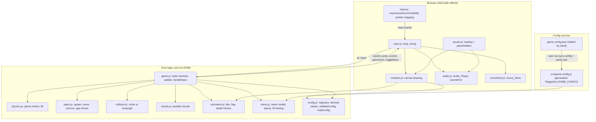
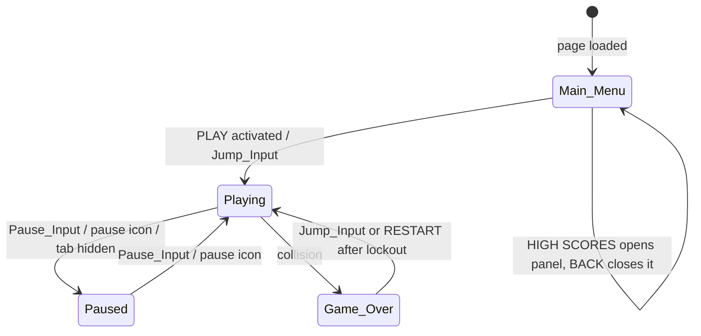
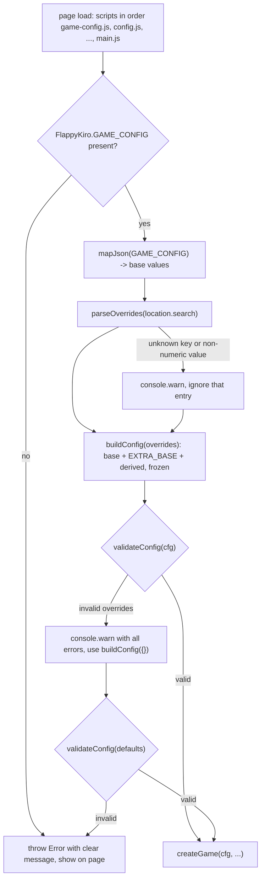
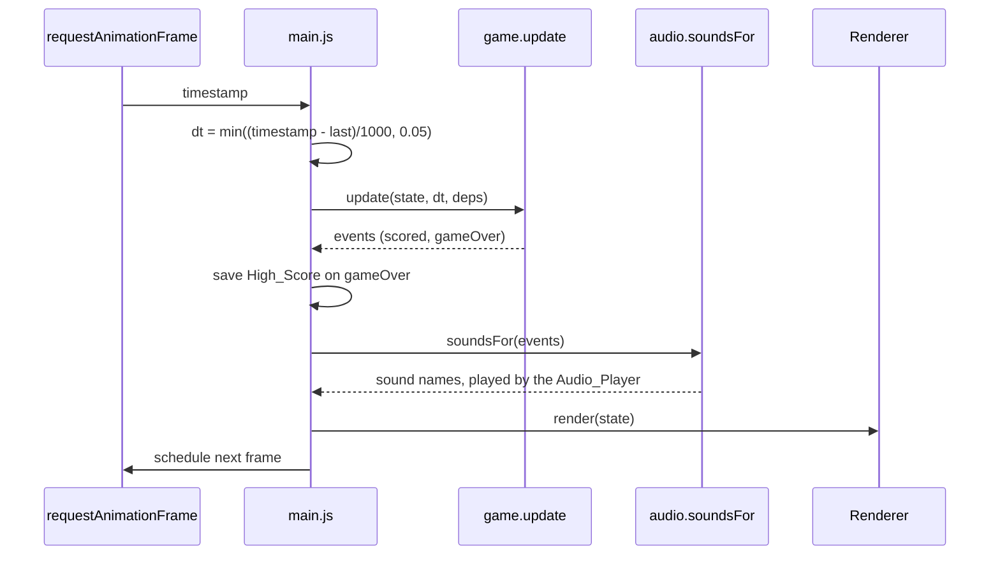

# Design Document: Flappy Kiro

## Overview

Flappy Kiro is a static, browser-based endless scroller built with an HTML canvas and vanilla JavaScript. There is no server-side component, no build step and no runtime dependency. The player steers Ghosty through gaps in an endless series of Pipe_Pairs. The game has four Game_States (Main_Menu, Playing, Paused, Game_Over), persists the High_Score in local storage, and uses four assets: `assets/ghosty.png`, `assets/jump.wav`, `assets/score.wav` and `assets/game_over.wav`.

The design follows `requirements.md` and four workspace files: `game-config.json` (tunable values), `ghosty-sprites.md` (sprite, hitbox and animation frames), `audio-assets.md` (sounds) and `ui-mockups.md` (menus, HUD and layout). Compared with the previous revision, the Ghost hitbox is now a circle, the tunables come from `game-config.json`, Ghosty has idle, flap and death animations, scoring plays a sound, and the Main_Menu, Game_Over screen and HUD have buttons and icons. The panel for HIGH SCORES is a sub-state of Main_Menu, so the four Game_States are unchanged.

### Research Summary

Key findings that shape the design:

- **Fixed logical resolution with CSS scaling.** Drawing to a 480 by 640 canvas and scaling it with CSS (`image-rendering: pixelated`, `ctx.imageSmoothingEnabled = false`) keeps pixel edges sharp and preserves the aspect ratio. See [MDN: Crisp pixel art look](https://developer.mozilla.org/en-US/docs/Games/Techniques/Crisp_pixel_art_look) and [MDN: imageSmoothingEnabled](https://developer.mozilla.org/en-US/docs/Web/API/CanvasRenderingContext2D/imageSmoothingEnabled).
- **Pointer coordinates under CSS scaling.** `getBoundingClientRect()` gives the on-screen rectangle of the canvas. Logical coordinates are `(clientX - rect.left) * WIDTH / rect.width`, and the same for y. This is needed for button and icon hit testing. See [MDN: getBoundingClientRect](https://developer.mozilla.org/en-US/docs/Web/API/Element/getBoundingClientRect).
- **Time-based loop.** `requestAnimationFrame` passes a high-resolution timestamp. Using the delta between timestamps, clamped to 50 ms, gives refresh-rate independent gameplay and avoids a large jump after a tab was hidden. See [MDN: requestAnimationFrame](https://developer.mozilla.org/en-US/docs/Web/API/window/requestAnimationFrame).
- **Page Visibility.** The `visibilitychange` event on `document` together with `document.visibilityState` lets the game auto-pause. See [MDN: Page Visibility API](https://developer.mozilla.org/en-US/docs/Web/API/Page_Visibility_API).
- **Audio.** `HTMLAudioElement.play()` returns a promise that rejects when autoplay is blocked. The rejection must be caught so the game keeps running. Setting `currentTime = 0` before `play()` restarts a sound that is still playing. See [MDN: HTMLMediaElement.play()](https://developer.mozilla.org/en-US/docs/Web/API/HTMLMediaElement/play).
- **Storage.** `localStorage` access can throw (private mode, disabled storage), so every read and write sits in a try/catch. See [MDN: Web Storage API](https://developer.mozilla.org/en-US/docs/Web/API/Web_Storage_API).
- **Sprite transforms.** The single `ghosty.png` can produce every animation frame at draw time with `translate`, `rotate` and `scale` on the 2D context around the sprite center, and a white flash with a tinted offscreen copy (`globalCompositeOperation = 'source-atop'`). See [MDN: Transformations](https://developer.mozilla.org/en-US/docs/Web/API/Canvas_API/Tutorial/Transformations) and [MDN: globalCompositeOperation](https://developer.mozilla.org/en-US/docs/Web/API/CanvasRenderingContext2D/globalCompositeOperation).
- **Circle against rectangle.** The distance from a circle center to a rectangle is the distance to the nearest point of the rectangle, found by clamping the center to the rectangle bounds. A hit is a distance below the radius. Comparing squared distances avoids a square root.
- **Loading config from `file://`.** `fetch()` of a local JSON file is blocked on `file://` origins in current browsers, and ES module scripts are blocked too. A classic `<script>` has no such restriction. See [MDN: fetch()](https://developer.mozilla.org/en-US/docs/Web/API/Window/fetch).
- **Query parameters.** `URLSearchParams` parses `location.search` without a server and works from `file://`. Values arrive as strings, so each override is converted with `Number()` and rejected unless it is finite. See [MDN: URLSearchParams](https://developer.mozilla.org/en-US/docs/Web/API/URLSearchParams).
- **Deep freeze.** `Object.freeze` is shallow, so each config group is frozen separately. See [MDN: Object.freeze()](https://developer.mozilla.org/en-US/docs/Web/JavaScript/Reference/Global_Objects/Object/freeze).
- **Pixel font.** A pixel-style font is drawn with a generic fallback (`"Press Start 2P", monospace`). No network font is required, so the game still works offline; the monospace fallback is acceptable.

Content was rephrased for compliance with licensing restrictions.

### Design Decisions

| Decision | Rationale |
|---|---|
| Split pure game logic from the browser shell | Collision, physics, spawning, scoring, animation frame selection, menu logic, state transitions and score storage become deterministic functions that can be property-tested in Node without a DOM. |
| Single mutable `GameState` object, updated by `update(state, dt, deps)` and `handleInput(state, input, deps)` | Simple for a small game; one place holds every value the requirements freeze while paused. |
| Injected `rng` and `clock` dependencies | Makes gap generation and timers reproducible in tests. |
| Y axis grows downward; upward velocity is negative | Matches canvas coordinates and `game-config.json`, where `jumpVelocity` is signed (-300). |
| Timers (invincibility, crash, lockout, flap, death) count down or up using the clamped `dt` of Playing/Game_Over updates | Pausing freezes them for free because no update runs, and hidden time is never counted. |
| `Pipe_Pair.x` is the left edge of the widest element (the 72 wide cap); the 64 wide body is inset by 4 | Gives one unambiguous left edge for spawning and one right edge (`x + 72`) for scoring and removal. |
| Classic scripts plus a global namespace | Works from `file://` with no server. |
| **`game-config.json` is the editable source; `src/game-config.js` is a generated classic script that mirrors it, guarded by a parity test** | See "Config source" below. `fetch()` fails on `file://` and would make startup asynchronous; a generated script keeps startup synchronous and offline, and the test makes drift impossible to miss. |
| Core functions take the config in use (`cfg`) as an argument instead of reading a global | Tests can run the same logic against the default config and against generated variations. |
| Validation at startup, with a whitelist for URL overrides | A bad value fails with a clear message (or falls back to defaults for URL overrides) instead of producing an unplayable game. |
| Circle hitbox with strict nearest-point distance | Matches `ghosty-sprites.md` and Requirement 6: touching is not a hit, and the 4 px margin outside the circle never collides. |
| A pure `animation.js` returns a frame description (index, offset, scale, rotation, tint); the renderer draws it from the single image or from an optional sprite sheet | Frame selection becomes testable without a canvas, and both frame sources (Requirement 18.6) share one code path. |
| A pure `menu.js` holds the menu model, button layout and hit testing; `game.js` calls it from `handleInput` | The panel is a sub-state of Main_Menu, so no new Game_State is needed, and keyboard, mouse and touch activation share one function. |
| Gameplay events (`jump`, `scored`, `gameOver`, `toggleMute`) are the only link from core to shell; a pure `soundsFor(events)` maps events to sound names | One score sound per score increase is checkable without audio. |
| Cloud speed bounds are validated as `min < max`, not only `min <= max` | Requirement 13.3 needs at least two distinct cloud speeds, which an equal min and max cannot give. |

### Config source

Three ways to get `game-config.json` into a page opened from `file://` were considered:

| Option | Result |
|---|---|
| `fetch('game-config.json')` with fallback to built-in defaults | Works over http only. From `file://` it always fails and falls back, so the JSON would be silently ignored in the most common way of opening the game. It also makes startup asynchronous and keeps a second copy of every default in code. |
| Inline `<script type="application/json">` in `index.html` | Works, but it moves the editable values into the HTML and duplicates the JSON file. |
| **Generated classic script `src/game-config.js`** | Works everywhere, loads synchronously before `config.js`, and has no second copy of the defaults in code. |

The third option is chosen. `src/game-config.js` contains only the JSON, assigned to `FlappyKiro.GAME_CONFIG` (and to `module.exports` in Node). `scripts/sync-config.js` regenerates it from `game-config.json` (`npm run sync-config`). A test asserts that `GAME_CONFIG` deep-equals the parsed `game-config.json`, so a stale copy fails `npm test`. The editing workflow is: edit `game-config.json`, run `npm run sync-config`, reload the page. `config.js` has no built-in copy of these values; if `GAME_CONFIG` is missing, startup fails with a clear message (see Error Handling).

Values that are not in the JSON are fixed by the requirements and companion documents rather than tuned: button and icon geometry from `ui-mockups.md`, and animation frame tables from `ghosty-sprites.md`. They live in `config.js` as `EXTRA_BASE` and join the same validated, frozen config, so tests read them from the config too.

## Architecture

The game is split into a pure logic core and a thin browser shell. The shell reads input and time, calls the core, and then draws and plays sounds based on the core's state and emitted events.



### Game State Machine

Only five transitions are permitted (Requirement 15). The HIGH SCORES panel opens and closes inside Main_Menu and is not a Game_State.



### Input Routing

`handleInput` receives semantic inputs and decides by mode. Space and Enter are not always Jump_Inputs: in Main_Menu they activate the selected Menu_Button (Requirement 10.7).

| Mode | Space | Enter | Up / Down | Pointer (click or touch) | Pause key | Hidden tab |
|---|---|---|---|---|---|---|
| Main_Menu, panel closed | Activate selected button (PLAY starts a round, HIGH SCORES opens the panel) | Same as Space | Move selection to the previous or next button | On a button: activate it. Elsewhere: Jump_Input, which starts a round (Requirement 2.2) | Ignored | Ignored |
| Main_Menu, panel open | Activate BACK | Activate BACK | Ignored | On BACK: activate it. Elsewhere: ignored (Requirement 17.7) | Ignored | Ignored |
| Playing | Jump_Input | Ignored | Ignored | On the mute icon: toggle mute. On the pause icon: Pause_Input. Elsewhere: Jump_Input | Pause | Pause |
| Paused | Ignored | Ignored | Ignored | On the pause icon: Pause_Input (resume). On the mute icon: toggle mute. Elsewhere: ignored | Resume | No change |
| Game_Over, lockout active | Ignored | Ignored | Ignored | Ignored, including RESTART | Ignored | Ignored |
| Game_Over, lockout over | Jump_Input (restart) | Activate RESTART (restart) | Ignored | On RESTART: restart. Elsewhere: Jump_Input (restart) | Ignored | Ignored |

The pointer is hit-tested first. Icons and buttons win over the Jump_Input fallback, so a tap on the pause icon never makes the ghost jump.

### Startup and Config Flow



### Frame Flow



### File Layout

```
index.html            canvas, three audio elements, script tags
game-config.json      editable tunables (source of truth)
scripts/sync-config.js  generates src/game-config.js from game-config.json
src/game-config.js    generated: FlappyKiro.GAME_CONFIG = <the JSON>
src/config.js         mapJson, EXTRA_BASE, derived values, validateConfig, parseOverrides, loadConfig
src/physics.js        ghost motion and tilt
src/pipes.js          pipe spawning, movement, gap selection, speed curve
src/collision.js      circle hitbox, nearest-point distance, boundaries
src/clouds.js         cloud creation, movement and wrap
src/animation.js      frame tables, idle/flap/death frame selection, frame placement
src/menu.js           menu model, button and icon layout, hit testing
src/game.js           GameState, update, handleInput, transitions
src/scoreStore.js     High_Score persistence
src/audio.js          Audio_Player with mute, soundsFor
src/assets.js         asset loading with per-asset fallbacks
src/renderer.js       canvas drawing
src/input.js          input mapping, pointer coordinate mapping
src/main.js           loop and wiring
assets/               ghosty.png, jump.wav, score.wav, game_over.wav, optional ghosty-sheet.png
tests/*.test.js       unit and property tests
```

`assets/score.wav` does not exist yet. It is created as part of implementation, following `audio-assets.md` (two soft tones a major third apart, about 0.2 s). The existing `jump.wav` (about 0.37 s) and `game_over.wav` (about 2.25 s) are longer than the 0.1 s and 0.3 s targets. The game works with any length, so trimming them is optional and not part of this design's correctness.

## Components and Interfaces

### game-config.json and src/game-config.js

`game-config.json` is used as is (the `_comment` key is ignored). `src/game-config.js` is generated:

```js
// src/game-config.js  GENERATED by scripts/sync-config.js from game-config.json. Do not edit.
(function (root) {
  root.GAME_CONFIG = { /* the parsed JSON, exactly as in game-config.json */ };
})(typeof window !== 'undefined' ? (window.FlappyKiro = window.FlappyKiro || {}) : module.exports);
```

### config.js

One plain file turns the JSON into the config used everywhere. It is a classic script: it attaches to `FlappyKiro` in the browser and also sets `module.exports` when it exists.

#### Mapping from JSON keys to config groups

`mapJson(json)` converts the camelCase, grouped JSON into the UPPER_SNAKE config groups. `unmapJson` is its inverse and exists for the round-trip test.

| JSON key | Config key | Unit | Default |
|---|---|---|---|
| `world.width` | `world.WIDTH` | px | 480 |
| `world.height` | `world.HEIGHT` | px | 640 |
| `world.groundHeight` | `world.GROUND_HEIGHT` | px | 80 |
| `ghost.spriteSize` | `ghost.SPRITE_SIZE` | px | 32 |
| `ghost.hitboxShape` | `ghost.HITBOX_SHAPE` | text | `"circle"` |
| `ghost.hitboxRadius` | `ghost.HITBOX_RADIUS` | px | 12 |
| `ghost.x` | `ghost.X` | px | 120 |
| `ghost.gravity` | `ghost.GRAVITY` | px/s² | 800 |
| `ghost.jumpVelocity` | `ghost.JUMP_VELOCITY` (signed, negative is up) | px/s | -300 |
| `pipes.pipeWidth` | `pipes.PIPE_WIDTH` | px | 64 |
| `pipes.capWidth` | `pipes.CAP_WIDTH` | px | 72 |
| `pipes.capHeight` | `pipes.CAP_HEIGHT` | px | 24 |
| `pipes.gapHeight` | `pipes.GAP_HEIGHT` | px | 140 |
| `pipes.gapMargin` | `pipes.GAP_MARGIN` | px | 60 |
| `pipes.pipeSpacing` | `pipes.PIPE_SPACING` | px | 350 |
| `pipes.maxGapShift` | `pipes.MAX_GAP_SHIFT` | px | 160 |
| `speed.wallSpeed` | `speed.INITIAL_SPEED` | px/s | 120 |
| `speed.speedIncrement` | `speed.SPEED_INCREMENT` | px/s | 10 |
| `speed.speedStepInterval` | `speed.SPEED_STEP_INTERVAL` | points | 5 |
| `speed.maxSpeed` | `speed.MAX_SPEED` | px/s | 240 |
| `timing.invincibilityMs` | `timing.INVINCIBILITY_MS` | ms | 1500 |
| `timing.crashMs` | `timing.CRASH_MS` | ms | 500 |
| `timing.crashFlashMs` | `timing.CRASH_FLASH_MS` | ms | 100 |
| `timing.blinkMs` | `timing.BLINK_MS` | ms | 100 |
| `timing.lockoutMs` | `timing.LOCKOUT_MS` | ms | 500 |
| `timing.maxFrameMs` | `timing.MAX_FRAME_MS` | ms | 50 |
| `clouds.speedMin` | `clouds.SPEED_MIN` | px/s | 10 |
| `clouds.speedMax` | `clouds.SPEED_MAX` | px/s | 60 |
| `clouds.layers[i].{width,depth,alpha}` | `clouds.LAYERS[i].{WIDTH,DEPTH,ALPHA}` | px, 0..1, 0..1 | see JSON |

#### Base values that are not in the JSON

```js
// EXTRA_BASE: fixed by ui-mockups.md and ghosty-sprites.md, not tuned in game-config.json.
const EXTRA_BASE = {
  ui: {
    BUTTON_WIDTH: 200,          // px
    BUTTON_HEIGHT: 44,          // px
    BUTTON_GAP: 16,             // px between stacked buttons
    MENU_BUTTON_Y: 400,         // px, top of the first Main_Menu button (PLAY)
    PANEL_BUTTON_Y: 400,        // px, top of BACK in the High_Scores_Panel
    GAME_OVER_BUTTON_Y: 400,    // px, top of RESTART
    ICON_SIZE: 32,              // px, mute and pause icons
    ICON_MARGIN: 16,            // px from the top and from the left or right edge
  },
  animation: {
    // Frame tables from ghosty-sprites.md. Offsets are px, scales are factors, rotation is degrees.
    IDLE_FRAMES: [ { ms: 300, offsetY: 0 }, { ms: 300, offsetY: -1 } ],
    FLAP_FRAMES: [ { ms: 60, scaleX: 1.0, scaleY: 1.15 },
                   { ms: 60, scaleX: 1.0, scaleY: 1.0 },
                   { ms: 80, scaleX: 1.1, scaleY: 0.9 } ],
    // Death frame durations are not listed: each lasts CRASH_FLASH_MS (derived).
    DEATH_FRAMES: [ { rotation: 0,  tint: true  },   // death_0 flashed white
                    { rotation: 45, tint: false },   // death_1 tilted 45
                    { rotation: 90, tint: true  },   // death_2 flashed white, tilted 90
                    { rotation: 90, tint: false } ], // death_3
    DEATH_FINAL: { rotation: 90, tint: false },      // death_4 resting frame, held
    // Optional sprite sheet: one horizontal strip, frame order idle(2), flap(3), death(5).
    SHEET_FILE: 'assets/ghosty-sheet.png',
  },
};
```

The five death frames of `ghosty-sprites.md` are `DEATH_FRAMES` (four timed frames) followed by `DEATH_FINAL`. The four timed frames last 400 ms and the Crash_Animation lasts 500 ms, so the final frame is already showing for the last 100 ms of the crash and stays until the next round (Requirement 18.5).

#### Derived values

```js
// Derived values: computed only here, never edited by hand, never overridable.
function derive(b) {
  const GROUND_TOP = b.world.HEIGHT - b.world.GROUND_HEIGHT;                        // 560
  const stackH = 2 * b.ui.BUTTON_HEIGHT + b.ui.BUTTON_GAP;
  return {
    world:  { GROUND_TOP, MENU_GHOST_Y: b.world.HEIGHT / 2 },                       // 320
    ghost:  { JUMP_SPEED: -b.ghost.JUMP_VELOCITY,                                   // 300, magnitude
              HITBOX_MARGIN: b.ghost.SPRITE_SIZE / 2 - b.ghost.HITBOX_RADIUS },     // 4
    pipes:  { CAP_INSET: (b.pipes.CAP_WIDTH - b.pipes.PIPE_WIDTH) / 2,              // 4
              GAP_CENTER_MIN: b.pipes.GAP_MARGIN + b.pipes.GAP_HEIGHT / 2,          // 130
              GAP_CENTER_MAX: GROUND_TOP - b.pipes.GAP_MARGIN - b.pipes.GAP_HEIGHT / 2, // 430
              SPAWN_X: b.world.WIDTH - b.pipes.PIPE_SPACING },                      // 130
    timing: { MAX_DT: b.timing.MAX_FRAME_MS / 1000,                                 // s
              DEATH_FRAME_MS: b.timing.CRASH_FLASH_MS },                            // 100
    clouds: { LAYER_SPEEDS: b.clouds.LAYERS.map(l =>
                b.clouds.SPEED_MIN + l.DEPTH * (b.clouds.SPEED_MAX - b.clouds.SPEED_MIN)) },
    ui:     { BUTTON_X: (b.world.WIDTH - b.ui.BUTTON_WIDTH) / 2,                    // 140
              MENU_STACK_BOTTOM: b.ui.MENU_BUTTON_Y + stackH,
              MUTE_ICON_X: b.ui.ICON_MARGIN,
              PAUSE_ICON_X: b.world.WIDTH - b.ui.ICON_MARGIN - b.ui.ICON_SIZE,
              ICON_Y: b.ui.ICON_MARGIN },
    animation: { IDLE_TOTAL_MS: sum(b.animation.IDLE_FRAMES, 'ms'),
                 FLAP_TOTAL_MS: sum(b.animation.FLAP_FRAMES, 'ms'),
                 DEATH_TOTAL_MS: b.animation.DEATH_FRAMES.length * b.timing.CRASH_FLASH_MS },
  };
}
```

Modules refer to values as `cfg.ghost.GRAVITY`, `cfg.pipes.GAP_CENTER_MIN` and so on. The rest of this document uses bare key names (`GRAVITY`, `HITBOX_RADIUS`, `GROUND_TOP`) for brevity.

#### Overrides, building and loading

```js
// Tunable keys exposed to ?name=value overrides. Anything not listed here is not overridable.
const TUNABLE = Object.freeze({
  gravity:          ['ghost',  'GRAVITY'],
  jumpVelocity:     ['ghost',  'JUMP_VELOCITY'],     // signed, negative is up
  hitboxRadius:     ['ghost',  'HITBOX_RADIUS'],
  gapHeight:        ['pipes',  'GAP_HEIGHT'],
  gapMargin:        ['pipes',  'GAP_MARGIN'],
  pipeSpacing:      ['pipes',  'PIPE_SPACING'],
  maxGapShift:      ['pipes',  'MAX_GAP_SHIFT'],
  wallSpeed:        ['speed',  'INITIAL_SPEED'],
  speedIncrement:   ['speed',  'SPEED_INCREMENT'],
  speedStepInterval:['speed',  'SPEED_STEP_INTERVAL'],
  maxSpeed:         ['speed',  'MAX_SPEED'],
  invincibilityMs:  ['timing', 'INVINCIBILITY_MS'],
  crashMs:          ['timing', 'CRASH_MS'],
  lockoutMs:        ['timing', 'LOCKOUT_MS'],
  cloudSpeedMin:    ['clouds', 'SPEED_MIN'],
  cloudSpeedMax:    ['clouds', 'SPEED_MAX'],
});

// mapJson(json)            -> base values { world, ghost, pipes, speed, timing, clouds }
// unmapJson(base)          -> json-shaped object (inverse of mapJson, without _comment)
// buildConfig(overrides?)  -> frozen { world, ghost, pipes, speed, timing, clouds, ui, animation }
//                             = mapJson(GAME_CONFIG) + overrides + EXTRA_BASE + derive(...)
// validateConfig(cfg)      -> { valid: boolean, errors: string[] }
// assertValidConfig(cfg)   -> throws Error listing every violated rule
// parseOverrides(search)   -> { overrides: { [group]: { [KEY]: number } }, warnings: string[] }
// loadConfig(search, log)  -> frozen config; never returns an invalid config
// DEFAULT_CONFIG           = buildConfig({})
```

#### validateConfig

`validateConfig(cfg)` collects every violated rule instead of stopping at the first, so one message lists all problems. Each error string starts with a stable rule id followed by a plain explanation, for example `gap.heightVsHitbox: GAP_HEIGHT (30) must be greater than 2 * HITBOX_RADIUS (24)`.

| Rule id | Relationship that must hold | Requirement |
|---|---|---|
| `number.finite` | Every numeric base value is a finite number; all sizes, speeds, durations and `SPEED_STEP_INTERVAL` are greater than 0; `SPEED_STEP_INTERVAL` is an integer; `SPEED_INCREMENT >= 0`; `GAP_MARGIN >= 0` | all |
| `ghost.shape` | `HITBOX_SHAPE` is `"circle"` | 6.1 |
| `ghost.radiusFits` | `HITBOX_RADIUS > 0` and `2 * HITBOX_RADIUS <= SPRITE_SIZE` (so `HITBOX_MARGIN >= 0`) | 6.1, 6.11 |
| `ghost.jumpUp` | `JUMP_VELOCITY < 0` | 3.2 |
| `ghost.insideWorld` | `0 < X < WIDTH` | 3.4 |
| `pipes.capCoversBody` | `CAP_WIDTH >= PIPE_WIDTH` | 6.2 |
| `pipes.spacing` | `PIPE_SPACING > CAP_WIDTH` | 4.2 |
| `gap.heightVsHitbox` | `GAP_HEIGHT > 2 * HITBOX_RADIUS` | 4.4 |
| `gap.fitsAboveGround` | `2 * GAP_MARGIN + GAP_HEIGHT <= GROUND_TOP`, equivalent to `GAP_CENTER_MIN <= GAP_CENTER_MAX` | 4.5 |
| `gap.shiftPositive` | `MAX_GAP_SHIFT > 0` | 4.6 |
| `speed.order` | `INITIAL_SPEED <= MAX_SPEED` | 4.9, 4.10 |
| `reach.fall` | Fall time for `MAX_GAP_SHIFT`: `sqrt(2 * MAX_GAP_SHIFT / GRAVITY) < PIPE_SPACING / MAX_SPEED` | 4.7 |
| `reach.climb` | Climb time for `MAX_GAP_SHIFT` with back-to-back jumps: `ceil(MAX_GAP_SHIFT / h) * (JUMP_SPEED / GRAVITY) < PIPE_SPACING / MAX_SPEED`, where `h = JUMP_SPEED^2 / (2 * GRAVITY)` is the rise of one jump | 4.7 |
| `clouds.order` | `SPEED_MIN < SPEED_MAX` (stricter than `<=` so that two distinct speeds exist) and `SPEED_MIN > 0` | 13.3, 13.5 |
| `clouds.belowScroll` | `SPEED_MAX < INITIAL_SPEED`, so every cloud speed is below the scroll speed at all times | 13.5 |
| `clouds.layers` | At least two layers; every `DEPTH` in [0, 1]; layer depths are distinct and increase with `WIDTH`; every `ALPHA` in (0, 1) | 13.2, 13.3, 13.4 |
| `timing.positive` | `INVINCIBILITY_MS`, `CRASH_MS`, `CRASH_FLASH_MS`, `BLINK_MS`, `LOCKOUT_MS` and `MAX_FRAME_MS` are all greater than 0 | 7.2, 7.7, 7.8, 8.1, 12.5 |
| `anim.tables` | `IDLE_FRAMES` has at least 2 frames, `FLAP_FRAMES` at least 1, `DEATH_FRAMES` at least 1, and every listed `ms` is greater than 0 | 18.1, 18.2, 18.5 |
| `anim.deathFitsCrash` | `DEATH_TOTAL_MS <= CRASH_MS`, so the final death frame is reached by the end of the Crash_Animation | 7.2, 18.5 |
| `ui.fits` | `BUTTON_WIDTH <= WIDTH`; `MENU_STACK_BOTTOM <= GROUND_TOP`; `MENU_BUTTON_Y`, `PANEL_BUTTON_Y` and `GAME_OVER_BUTTON_Y` plus `BUTTON_HEIGHT` are at most `GROUND_TOP`; the two icons do not overlap each other (`MUTE_ICON_X + ICON_SIZE <= PAUSE_ICON_X`) | 17.1, 17.8 |

Reachability with the new defaults, from `game-config.json`: `h = 300² / (2 * 800) = 56.25 px`, `ceil(160 / 56.25) = 3` jumps, each jump lasts `300 / 800 = 0.375 s`, so the climb takes `3 * 0.375 = 1.125 s`. The fall takes `sqrt(2 * 160 / 800) = sqrt(0.4) ≈ 0.632 s`. The limit is `350 / 240 ≈ 1.458 s`, so both rules pass. The climb estimate is a deliberate upper bound: it assumes each jump is taken at the apex of the previous one.

The gap is 140 px high and the hitbox diameter is 24 px, so `gap.heightVsHitbox` passes with 116 px of room. `GAP_CENTER_MIN` is 130 and `GAP_CENTER_MAX` is 430. The menu stack bottom is `400 + 2 * 44 + 16 = 504`, which is above `GROUND_TOP` (560), so `ui.fits` passes.

`assertValidConfig(cfg)` calls `validateConfig` and throws `Error('Invalid Flappy Kiro config:\n - ' + errors.join('\n - '))` when `valid` is false.

#### URL overrides

`parseOverrides(search)` reads `new URLSearchParams(search)` and, for each entry:

- If the name is not a key of `TUNABLE`, it adds a warning (`unknown parameter "foo"`) and ignores the entry.
- If the value is empty, or `Number(value)` is not finite, it adds a warning (`parameter "gravity" must be a number, got "abc"`) and ignores the entry.
- Otherwise it stores the number under the mapped group and key. Values are not rounded or clamped here; range and relationship checks belong to `validateConfig`.

If a name appears more than once, the last value wins.

`loadConfig(search, log)` runs the startup flow shown in the Startup and Config Flow diagram:

1. `parseOverrides` and `buildConfig(overrides)`.
2. If `validateConfig` accepts the result, return it. Warnings from step 1 go to `log.warn`.
3. Otherwise `log.warn` reports all errors and that the defaults are used, and the function returns `DEFAULT_CONFIG`.
4. `DEFAULT_CONFIG` itself is checked with `assertValidConfig` when the module loads. If someone edits `game-config.json` into an invalid combination and syncs it, the page fails at startup with the error list instead of running a broken game.

### physics.js

```js
// Every core function takes the config in use (cfg) as its first argument.
// Applies gravity for dt seconds (semi-implicit Euler). x is constant.
function stepGhost(cfg, ghost, dt)     // -> { y, vy }  (vy' = vy + GRAVITY*dt; y' = y + vy'*dt)
function applyJump(cfg, ghost)         // -> { y, vy: JUMP_VELOCITY }
function tiltFor(vy)                   // -> radians; < 0 when vy < 0, 0 when vy === 0, > 0 when vy > 0
function clampDt(cfg, rawSeconds)      // -> min(max(raw, 0), MAX_DT)
```

`ghost.y` is the vertical center of the sprite and of the hitbox circle.

### pipes.js

```js
// Pipe_Pair: { x, gapCenter, scored }   x = left edge of the 72 wide cap
function gapCenterRange(cfg, prevCenter)    // -> [min, max] for the next gap center
function chooseGapCenter(cfg, prevCenter, rng) // uniform over gapCenterRange
function speedForScore(cfg, score)     // min(MAX_SPEED, INITIAL_SPEED + SPEED_INCREMENT * floor(score / SPEED_STEP_INTERVAL))
function spawnPair(cfg, pairs, rng)    // appends a pair at x = WIDTH
function shouldSpawn(cfg, pairs)       // true when last.x <= SPAWN_X (WIDTH - PIPE_SPACING)
function movePairs(pairs, speed, dt)   // x -= speed * dt
function removeOffscreen(cfg, pairs)   // drops pairs with x + CAP_WIDTH < 0
function pipeRects(cfg, pair)          // -> [topBody, topCap, bottomBody, bottomCap]
```

Gap center bounds. A gap spans `center ± GAP_HEIGHT / 2`. With a margin of `GAP_MARGIN` to the Ceiling and to the Ground (top edge at `GROUND_TOP`), the center lies in `[GAP_CENTER_MIN, GAP_CENTER_MAX]`. For a non-first pair the range is intersected with `[prev - MAX_GAP_SHIFT, prev + MAX_GAP_SHIFT]`. The intersection is never empty because `prev` itself is always in `[GAP_CENTER_MIN, GAP_CENTER_MAX]`, and `validateConfig` guarantees that interval is not empty (`gap.fitsAboveGround`). With the defaults the range is [130, 430].

### collision.js (Collision_Detector)

The Ghost hitbox is a circle (Requirement 6.1). Pipe hitboxes are rectangles. The detector compares squared distances so no square root is needed.

```js
// Circle: { cx, cy, r }   Rect: { x, y, w, h }
function ghostCircle(cfg, ghost)           // -> { cx: X, cy: ghost.y, r: HITBOX_RADIUS }
function nearestPoint(rect, cx, cy)        // -> { x: clamp(cx, rect.x, rect.x + rect.w),
                                           //      y: clamp(cy, rect.y, rect.y + rect.h) }
function distanceSqToRect(circle, rect)    // squared distance from the circle center to nearestPoint
function circleHitsRect(circle, rect)      // distanceSqToRect(circle, rect) < r * r   (strict)
function hitsPipe(cfg, ghost, pairs)       // any pipe rectangle hit; a pipe hitbox is the union of its body and cap
function hitsGround(cfg, ghost)            // ghost.y + HITBOX_RADIUS >= GROUND_TOP
function hitsCeiling(cfg, ghost)           // ghost.y - HITBOX_RADIUS <= 0
function detect(cfg, ghost, pairs, invincible) // -> { pipe, ground, ceiling } booleans
```

Rules:

- A hit needs a distance strictly below `HITBOX_RADIUS`. A distance of exactly `HITBOX_RADIUS` is not a hit (Requirement 6.10), so touching never ends a round. Because the comparison is on squared values, tests construct exact-touch cases from integer and half-integer coordinates, where the floating-point arithmetic is exact.
- The corner of the 32 by 32 sprite square outside the circle (the `HITBOX_MARGIN` of 4 px at each extreme) takes no part in any test (Requirement 6.11).
- A center inside a rectangle has distance 0, which is a hit.
- Ground and Ceiling use the circle extremes: `y + HITBOX_RADIUS >= GROUND_TOP` and `y - HITBOX_RADIUS <= 0` (Requirements 6.7, 6.8). These two use `>=` and `<=` as the requirements say "reaches or passes".
- `detect` skips the pipe test when `invincible` is true but always evaluates ground and ceiling.

### clouds.js

```js
// Cloud: { x, y, width, speed, alpha }
function createClouds(cfg, rng)        // one cloud per LAYERS entry (several per layer allowed)
function moveClouds(cfg, clouds, dt)   // x -= speed * dt; wrap to WIDTH when x + width < 0, y unchanged
```

Cloud speeds come from the derived `LAYER_SPEEDS`, which maps each layer depth linearly onto `[SPEED_MIN, SPEED_MAX]`. Because `clouds.layers` requires depth to increase with width, smaller clouds are slower by construction. With the defaults the speeds are 15, 35 and 55.

### animation.js

A pure module. It turns timers into a frame description. It never touches a canvas. The renderer draws the description from the single image (runtime transforms) or from an optional sprite sheet, so both frame sources (Requirement 18.6) share one selection path.

```js
// FrameDesc: {
//   anim: 'idle' | 'flap' | 'death',
//   index: number,                // frame index within its animation
//   sheetIndex: number,           // index in the sprite-sheet strip: idle 0..1, flap 2..4, death 5..9
//   offsetY: number, scaleX: number, scaleY: number,   // runtime transform of the single image
//   rotation: number,             // radians; for death frames from the table, otherwise from tiltFor
//   tint: boolean                 // true = draw the white-flash version
// }
function frameAt(table, elapsedMs)            // -> index in a timed table; clamps to the last frame
function idleFrame(cfg, clockMs)              // loops: index = floor(clock / frame) over the cumulative table, modulo IDLE_TOTAL_MS
function flapFrame(cfg, flapMs)               // flapMs null or >= FLAP_TOTAL_MS -> idle frame 0, else the flap frame
function deathFrame(cfg, deathMs)             // floor(deathMs / DEATH_FRAME_MS) for the timed frames, then DEATH_FINAL held
function currentFrame(state)                  // picks the animation from the mode and timers (below)
function frameDest(cfg, ghost)                // base destination rect: SPRITE_SIZE square centered on (X, ghost.y)
function sheetSource(cfg, sheetIndex)         // source rect in the sheet: { x: sheetIndex * SPRITE_SIZE, y: 0, w: SPRITE_SIZE, h: SPRITE_SIZE }
```

Selection by mode, in `currentFrame`:

| Mode | Animation | Timer |
|---|---|---|
| Main_Menu | idle, looping | `animClockMs`, advanced by `update` only in Main_Menu |
| Playing, Paused | flap if `flapMs` is not null and below `FLAP_TOTAL_MS`, otherwise idle frame 0 | `flapMs`, set to 0 by every jump and advanced by `update` in Playing, so Paused freezes it |
| Game_Over | death | `deathMs`, advanced by `update` in Game_Over |

The rotation of idle and flap frames is `tiltFor(ghost.vy)`, so the ghost still tilts with its motion (Requirements 3.5, 3.7). Death frames take their fixed rotation from the table instead. All frames are drawn from the base rectangle `frameDest`, which is the 32 by 32 sprite square centered on the ghost, and the offset, scale and rotation are applied around that center (Requirement 18.7). With a sprite sheet, `sheetIndex` selects the source rectangle and the transform fields are set to identity so art is not distorted twice. If the sheet is missing, the renderer silently falls back to runtime transforms of `ghosty.png`.

The Crash_Animation flash (Requirement 7.2) is the white tint on death frames 0 and 2. Each death frame lasts `CRASH_FLASH_MS`, so the ghost flashes every 100 milliseconds. The ghost blink for invincibility is separate: it hides the sprite on odd `BLINK_MS` intervals and does not change the frame.

### menu.js

A pure module for the menu model, layout and hit testing.

```js
// MenuState: { selected: 'PLAY' | 'HIGH_SCORES', panelOpen: boolean }
function initialMenu()                          // -> { selected: 'PLAY', panelOpen: false }
function buttonsFor(mode, menu)                 // Main_Menu: ['PLAY','HIGH_SCORES']; panel open: ['BACK']; Game_Over: ['RESTART']; else []
function buttonRect(cfg, name)                  // { x: BUTTON_X, y, w: BUTTON_WIDTH, h: BUTTON_HEIGHT }
                                                // PLAY y = MENU_BUTTON_Y, HIGH_SCORES y = MENU_BUTTON_Y + BUTTON_HEIGHT + BUTTON_GAP,
                                                // BACK y = PANEL_BUTTON_Y, RESTART y = GAME_OVER_BUTTON_Y
function iconRect(cfg, name)                    // 'MUTE' -> (MUTE_ICON_X, ICON_Y), 'PAUSE' -> (PAUSE_ICON_X, ICON_Y), ICON_SIZE square
function iconsVisible(mode)                     // true in Playing and Paused, false in Main_Menu and Game_Over
function hitTest(cfg, state, x, y)              // -> 'PLAY' | 'HIGH_SCORES' | 'BACK' | 'RESTART' | 'MUTE' | 'PAUSE' | null
function navigate(menu, dir)                    // 'up' | 'down' -> new MenuState; wraps over the button list; ignored when the panel is open
function activate(menu, name)                   // 'HIGH_SCORES' -> panelOpen true; 'BACK' -> panelOpen false; 'PLAY' and 'RESTART' are handled by game.js
```

`hitTest` considers only the buttons and icons that exist in the current mode (`buttonsFor` and `iconsVisible`). A point is inside a rectangle when `x >= rect.x && x < rect.x + rect.w` and the same for y (half-open), so two rectangles that touch never both claim a point. Buttons are 200 by 44, centered horizontally (`BUTTON_X = 140`) and 16 apart. Icons are 32 by 32 with a 16 margin: the mute icon at the top left, the pause icon at the top right (Requirement 17.8).

The selected button is initially PLAY (Requirement 17.2). The renderer draws a white border around the selected button.

### game.js

```js
function createGame(cfg, highScore, rng)   // -> GameState in Main_Menu with menu = initialMenu()
function handleInput(state, input, deps)   // input: { kind: 'space' | 'enter' | 'up' | 'down' | 'pause' | 'hidden' }
                                           //      | { kind: 'pointer', x, y }   (logical coordinates); returns events
function update(state, dt, deps)           // dt already clamped; returns array of events
function startRound(state, rng)            // resets round values, starts invincibility, applies jump
```

`deps` is `{ cfg, rng }`; `createGame` also stores `cfg` on the state so `startRound` uses the same config. `handleInput` and `update` return events:

| Event | Emitted when | Sound |
|---|---|---|
| `{ type: 'jump' }` | A jump is applied: in Playing, on a round start from Main_Menu, and on a restart from Game_Over | `jump` |
| `{ type: 'scored' }` | The Score increases by 1 (one event per increase, also during invincibility) | `score` |
| `{ type: 'gameOver', score, previousHighScore }` | The mode changes to Game_Over | `game_over` |
| `{ type: 'toggleMute' }` | The pointer hit the mute icon | none (shell toggles mute) |

The shell owns audio and storage; the core stays pure.

Update order while Playing:

1. Decrement the invincibility timer; advance `flapMs`.
2. Step the ghost physics.
3. Move pipes and ground at the current speed, move clouds, remove off-screen pairs, spawn if needed.
4. Score pairs whose right edge the ghost center has passed; emit one `scored` per increase; recompute speed from the new score.
5. Run collision detection; on a hit change to Game_Over, end invincibility, start the crash timer, reset `deathMs` to 0 and set the lockout, and emit `gameOver`.

While Game_Over, `update` advances the crash animation: `deathMs` grows, the ghost falls under gravity until its circle bottom reaches the ground boundary (`y + HITBOX_RADIUS = GROUND_TOP`, then `y` is clamped there), timers count down, and world positions stay unchanged. While Main_Menu, `update` advances only `animClockMs`. While Paused, `update` changes nothing.

Starting a round (`startRound`) sets the score to 0, the speed to `INITIAL_SPEED`, clears pipes, starts invincibility, applies a jump (flap animation restarts: `flapMs = 0`), resets `deathMs`, closes the panel, and emits `jump`. Both Main_Menu start paths (PLAY activation, a pointer on an empty area) and the Game_Over restart paths (Space, Enter on RESTART, a pointer on RESTART or on an empty area) call it, so they produce identical results.

### scoreStore.js (Score_Store)

```js
function parseHighScore(raw)           // string|null -> non-negative integer, else 0
function load(storage)                 // try/catch around storage.getItem
function save(storage, score)          // try/catch around storage.setItem
function recordIfHigher(storage, score, stored) // saves and returns new high score only if score > stored
```

### audio.js (Audio_Player)

```js
function createAudioPlayer(elements)   // elements: { jump, score, game_over }; any may be null (failed asset)
// play(name): if muted, return; if the element is missing, return;
//             otherwise element.currentTime = 0; element.play().catch(() => {})
// toggleMute(), isMuted()
function soundsFor(events)             // events -> sound names in order, one per event of type jump, scored or gameOver
```

A missing element (failed asset) makes `play` a no-op for that sound only, so a failed `score.wav` leaves the jump and collision sounds working (Requirement 19.6). Mute, autoplay blocking and restart-from-the-beginning apply to all three sounds in the same way (Requirements 11.2, 11.3, 11.4, 19.4, 19.5).

### assets.js

Loads each of the four assets (and the optional sprite sheet) independently. A failure replaces only that asset: the sprite falls back to a drawn 24 by 24 white square centered on the Ghost center, a failed sound becomes silence, and a missing sheet falls back to runtime transforms of `ghosty.png`. Other assets are unaffected.

### input.js

- `keydown`: Space → `space` (calls `preventDefault`), Enter → `enter`, ArrowUp → `up`, ArrowDown → `down`, P or Escape → `pause`, M → toggle mute. Events with `event.repeat === true` are ignored.
- `mousedown` and `touchstart` on the canvas → `{ kind: 'pointer', x, y }`, with `x` and `y` from `toLogical`. Hit testing against buttons and icons happens inside `handleInput`, not here.
- `toLogical(cfg, rect, clientX, clientY)` → `{ x: (clientX - rect.left) * WIDTH / rect.width, y: (clientY - rect.top) * HEIGHT / rect.height }`, where `rect` is the canvas bounding rectangle.
- The pause and mute icons are drawn on the canvas, so they need no DOM buttons; they are activated through `pointer` events and `hitTest`.
- `document.visibilitychange` with `hidden` → `hidden` (treated as a pause when Playing). On becoming visible the loop resets its `last` timestamp so the hidden duration is never applied.

### renderer.js

Draws in this order: sky background, clouds (alpha between 0 and 1), pipes with caps, ground, ghost, HUD, and the overlay for the current state. It sets `imageSmoothingEnabled = false` and scales the canvas with CSS to fit the window while preserving the 480:640 aspect ratio.

- **Ghost.** Takes the `FrameDesc` from `currentFrame`, translates to the ghost center, applies rotation and scale, draws the base rectangle (from `ghosty.png` or from the sheet via `sheetSource`), and uses the tinted copy when `tint` is true. During invincibility the ghost is hidden on odd `BLINK_MS` intervals.
- **Main_Menu.** Title at y = 140, the idle ghost at `MENU_GHOST_Y`, the PLAY and HIGH SCORES buttons (the selected one with a white border), the BEST value, and the hint "Press SPACE or tap to play". The mute and pause icons are hidden. With the panel open it shows "BEST: N" and the BACK button.
- **Playing and Paused.** The Score centered at the top in white with a dark outline, the mute icon at the top left and the pause icon at the top right (each 32 by 32 with a 16 margin). Paused adds a 50% black dim, "PAUSED" and "Press P to resume".
- **Game_Over.** After the Crash_Animation ends: "GAME OVER", a panel with SCORE and BEST right-aligned, "NEW BEST!" in the highlight color only when `newHighScore` is true, the RESTART button and the hint "Press SPACE or tap to restart".
- **Palette** (from `ui-mockups.md`): sky `#70C5CE`, pipes `#5DB02A` with `#3E7A1B` outline, ground `#DED895` with `#8B7B3A` stripe, text `#FFFFFF` with `#2B2B2B` outline, dim `#000000` at 50%, highlight `#FFD54A`. These are fixed drawing constants in `renderer.js`; they are not gameplay tunables.

## Data Models

```js
/** @typedef {{ x:number, gapCenter:number, scored:boolean }} PipePair */
/** @typedef {{ x:number, y:number, width:number, speed:number, alpha:number }} Cloud */
/** @typedef {{ x:number, y:number, w:number, h:number }} Rect */
/** @typedef {{ cx:number, cy:number, r:number }} Circle */
/** @typedef {{ selected:'PLAY'|'HIGH_SCORES', panelOpen:boolean }} MenuState */

/**
 * @typedef {Object} GameState
 * @property {Object} cfg                        // frozen config in use for this game
 * @property {'Main_Menu'|'Playing'|'Paused'|'Game_Over'} mode
 * @property {{ y:number, vy:number }} ghost      // y is the sprite and circle center; x is always cfg.ghost.X
 * @property {PipePair[]} pipes
 * @property {Cloud[]} clouds
 * @property {number} groundOffset                // scrolls at the shared Scroll_Speed
 * @property {number} score
 * @property {number} highScore
 * @property {number} speed                       // shared Scroll_Speed
 * @property {number} invincibleMs                // remaining, 0 when inactive
 * @property {number} crashMs                     // remaining Crash_Animation time
 * @property {number} lockoutMs                   // remaining Game_Over input lockout
 * @property {boolean} newHighScore
 * @property {number|null} lastGapCenter          // null before the first pair of a round
 * @property {MenuState} menu                     // selection and High_Scores_Panel flag (sub-state of Main_Menu)
 * @property {number} animClockMs                 // idle animation clock, advances only in Main_Menu
 * @property {number|null} flapMs                 // time since the last jump; null before the first jump of a round
 * @property {number} deathMs                     // time since the collision, advances in Game_Over
 */
```

The config object has the shape `{ world, ghost, pipes, speed, timing, clouds, ui, animation }`, where each group holds the base values and derived values listed in the Components section. It is created once at startup, frozen, and never mutated.

Local storage holds one key, `flappyKiro.highScore`, whose value is the decimal string of a non-negative integer. Any other content is read as 0.

Menu ghost position: the Ghost rests at the derived fixed vertical position `MENU_GHOST_Y` (`HEIGHT / 2`, 320 with the defaults) in Main_Menu and at the start of a round.

## Correctness Properties

*A property is a characteristic or behavior that should hold true across all valid executions of a system-essentially, a formal statement about what the system should do. Properties serve as the bridge between human-readable specifications and machine-verifiable correctness guarantees.*

All properties are stated in terms of the config in use (`GRAVITY`, `JUMP_VELOCITY`, `HITBOX_RADIUS`, `GAP_HEIGHT`, `GAP_CENTER_MIN`, `GROUND_TOP`, `BUTTON_WIDTH` and so on) and never in terms of literal numbers. Property tests read these values from the config under test. Properties 1 to 42 run against the default config and, through Property 47, against generated valid variations of it. Properties 43 to 46 cover the config itself.

Reflection on redundancy: the prework produced many testable criteria. Criteria that repeat the same rule were merged. Ground and ceiling collisions became one property with pipe collisions. Everything that freezes the world outside Playing became one freeze property. All permitted and forbidden state transitions became one state machine property. Round-start values appear in one property used for every start path. Menu activation by Space, Enter and pointer is one property, and RESTART against Jump_Input is one equivalence property, because the other game-over properties already cover the lockout timing. The pause icon and the Pause_Input are one equivalence property.

### Property 1: Gravity integration

*For any* valid config, any ghost state and any frame time `dt` in (0, `MAX_DT`], stepping the ghost SHALL set the vertical velocity to the old velocity plus `GRAVITY * dt` and SHALL set the position to the old position plus the new velocity times `dt`.

**Validates: Requirements 3.1, 3.6**

### Property 2: Jump sets a fixed upward velocity

*For any* valid config and any ghost state in Playing, applying a jump SHALL set the vertical velocity to `JUMP_VELOCITY` (negative, so upward) regardless of the previous velocity or position, and SHALL leave the position unchanged.

**Validates: Requirements 3.2**

### Property 3: Tilt follows the direction of motion

*For any* vertical velocity, the tilt angle SHALL be upward (negative) when the ghost moves up, downward (positive) when it moves down, and exactly zero when the velocity is zero.

**Validates: Requirements 3.5, 3.7**

### Property 4: Frame time is clamped

*For any* valid config and any raw elapsed time, the clamped time SHALL lie in [0, `MAX_DT`] seconds and SHALL equal the raw time whenever the raw time is already within that range.

**Validates: Requirements 12.5**

### Property 5: Gap position respects margins and shift limit

*For any* valid config, any random value from the generator and any previous gap center in [`GAP_CENTER_MIN`, `GAP_CENTER_MAX`], the chosen gap center SHALL lie in [`GAP_CENTER_MIN`, `GAP_CENTER_MAX`] (so the gap stays at least `GAP_MARGIN` from the Ceiling and the Ground) and SHALL differ from the previous gap center by at most `MAX_GAP_SHIFT`. *For any* valid config and random value, the first gap of a round SHALL lie in [`GAP_CENTER_MIN`, `GAP_CENTER_MAX`].

**Validates: Requirements 4.5, 4.6**

### Property 6: Pipe pair geometry

*For any* valid config and any pipe pair, the pipe rectangles SHALL consist of a `PIPE_WIDTH` wide body and a `CAP_WIDTH` by `CAP_HEIGHT` cap on each side of a gap that is exactly `GAP_HEIGHT` high, `GAP_HEIGHT` SHALL be greater than `2 * HITBOX_RADIUS`, and each pipe hitbox SHALL be the union of its body and cap rectangles.

**Validates: Requirements 4.3, 4.4, 6.2**

### Property 7: Spawn rule

*For any* valid config and any list of pipe pairs, the spawn test SHALL be true if and only if the most recently spawned pair has its left edge at or to the left of `WIDTH - PIPE_SPACING`.

**Validates: Requirements 4.2**

### Property 8: Scroll speed curve

*For any* valid config and any score, the scroll speed SHALL equal the lesser of `MAX_SPEED` and `INITIAL_SPEED + SPEED_INCREMENT * floor(score / SPEED_STEP_INTERVAL)`, so the speed never decreases as the score grows and never exceeds `MAX_SPEED`.

**Validates: Requirements 4.10**

### Property 9: Pipes and ground scroll together

*For any* valid config, game state in Playing, speed and frame time, an update SHALL move every pipe pair and the ground leftward by exactly the same distance `speed * dt`.

**Validates: Requirements 4.8, 4.11, 9.6**

### Property 10: Off-screen pairs are removed

*For any* valid config and any list of pipe pairs, removal SHALL drop exactly the pairs whose right edge (`x + CAP_WIDTH`) is left of 0 and SHALL keep every other pair unchanged.

**Validates: Requirements 4.12**

### Property 11: World is frozen outside Playing

*For any* game state whose mode is Main_Menu, Paused or Game_Over and any sequence of updates, the pipe positions, ground offset, cloud positions, score and speed SHALL stay unchanged. *For any* Main_Menu state the ghost position SHALL stay at `MENU_GHOST_Y`. *For any* Paused state, the ghost position, ghost velocity, remaining invincibility, flap timer and animation clock SHALL also stay unchanged, and pausing then resuming SHALL leave the state equal to the state before the pause.

**Validates: Requirements 2.3, 4.13, 7.3, 13.8, 14.4, 14.6, 14.7**

### Property 12: Round start resets the round

*For any* valid config, any game state in Main_Menu or in Game_Over past the lockout, any previous score, pipes and high score, and any start path (PLAY activation by Space, Enter or pointer, a pointer on an empty menu area, or a restart by Space, Enter on RESTART or a pointer), a start or restart SHALL produce a Playing state with score 0, speed `INITIAL_SPEED`, no pipe pairs from the previous round, `INVINCIBILITY_MS` of invincibility, a ghost velocity of `JUMP_VELOCITY`, a flap timer of 0, a closed High_Scores_Panel and a jump event, and every start path SHALL produce the same state.

**Validates: Requirements 2.2, 4.9, 4.14, 5.3, 7.7, 8.2, 17.4**

### Property 13: Scoring counts each passed pair once

*For any* valid config, set of pipe positions and sequence of updates, with or without active invincibility, the score SHALL equal the number of pairs whose right edge the ghost center has passed, and each pair SHALL add at most 1 to the score no matter how many updates follow.

**Validates: Requirements 5.1, 5.4, 5.5**

### Property 14: Ghost hitbox is a circle centered on the sprite

*For any* valid config and any ghost vertical position, the ghost hitbox SHALL be a circle with center `(X, y)`, the center of the `SPRITE_SIZE` by `SPRITE_SIZE` sprite, and radius `HITBOX_RADIUS`, so that it lies inside the sprite square with a margin of `SPRITE_SIZE / 2 - HITBOX_RADIUS` at the horizontal and vertical extremes.

**Validates: Requirements 3.4, 6.1**

### Property 15: Circle against rectangle uses a strict nearest-point distance

*For any* circle and any rectangle, the squared distance from the circle center to the rectangle SHALL equal the squared distance to the nearest point of the rectangle (zero when the center is inside), a collision SHALL be reported if and only if that distance is strictly less than the radius, and a circle at exactly the radius distance from the rectangle SHALL report no collision. *For any* valid config, a ghost whose sprite square overlaps a pipe rectangle only inside the margin outside the circle SHALL produce no collision.

**Validates: Requirements 6.6, 6.10, 6.11**

### Property 16: Collision outcomes

*For any* valid config, ghost position and set of pipe pairs, the detector SHALL report a ground collision if and only if `y + HITBOX_RADIUS` is at or below `GROUND_TOP`, a ceiling collision if and only if `y - HITBOX_RADIUS` is at or above 0, and a pipe collision if and only if the pipe test is enabled and the ghost circle collides with a pipe hitbox. *For any* ghost circle fully inside a gap and clear of both boundaries, no collision SHALL be reported. During invincibility the pipe test SHALL be disabled while the ground and ceiling tests stay enabled, and any reported collision in Playing SHALL change the mode to Game_Over.

**Validates: Requirements 6.3, 6.4, 6.5, 6.6, 6.7, 6.8, 6.9, 7.9, 7.10, 15.6**

### Property 17: Invincibility timer and blink

*For any* valid config and sequence of frame times in Playing, the remaining invincibility SHALL never increase and SHALL reach 0 once `INVINCIBILITY_MS` have elapsed. *For any* remaining time, the ghost SHALL be visible or hidden according to the parity of the `BLINK_MS` interval index while the timer is active, SHALL be visible when the timer is 0, and invincibility SHALL be 0 in Game_Over. After the timer reaches 0 pipe collisions SHALL apply. A collision SHALL NOT start a new invincibility period.

**Validates: Requirements 7.8, 7.11, 7.12, 7.13**

### Property 18: Crash animation stays above the ground

*For any* valid config and ghost state at the moment of a collision, running the crash animation SHALL never move the circle bottom (`y + HITBOX_RADIUS`) below `GROUND_TOP`, and SHALL end the Crash_Animation after `CRASH_MS`, after which the game over overlay is shown.

**Validates: Requirements 7.2, 7.4**

### Property 19: New high score indication

*For any* final score and previously stored high score, the new high score flag SHALL be true if and only if the final score is greater than the previously stored high score, and the "NEW BEST!" indication SHALL be shown if and only if the flag is true.

**Validates: Requirements 7.6, 17.11**

### Property 20: Game over input lockout

*For any* valid config and any time elapsed since the transition to Game_Over that is less than `LOCKOUT_MS`, any Jump_Input (Space or pointer) SHALL change nothing and SHALL emit no jump event. *For any* elapsed time of at least `LOCKOUT_MS`, a Jump_Input SHALL restart the round and emit exactly one jump event.

**Validates: Requirements 8.1, 8.2, 8.3, 8.4, 15.7**

### Property 21: State machine only takes permitted transitions

*For any* sequence of inputs (space, enter, up, down, pointer, pause, hidden) and updates, every observed change of mode SHALL be one of Main_Menu to Playing, Playing to Paused, Paused to Playing, Playing to Game_Over or Game_Over to Playing. Pause_Input SHALL be ignored in Main_Menu and Game_Over, Jump_Input SHALL be ignored in Paused, opening or closing the High_Scores_Panel SHALL NOT change the mode, and a hidden tab while Playing SHALL change the mode to Paused.

**Validates: Requirements 10.6, 12.3, 14.1, 14.2, 14.8, 15.2, 15.3, 15.4, 15.5, 15.8, 15.9, 17.5, 17.6**

### Property 22: Key repeat is ignored

*For any* mapped key (Space, Enter, ArrowUp, ArrowDown, P, Escape, M), a key event with the repeat flag set SHALL produce no input, and the same key without the repeat flag SHALL produce exactly one input.

**Validates: Requirements 10.5**

### Property 23: Mute suppresses every sound

*For any* sequence of play requests (jump, score and game over) and mute toggles, a sound SHALL be played if and only if the player is not muted at the time of the request, its element exists, and playing it again while it is playing SHALL restart it from the beginning.

**Validates: Requirements 11.2, 11.4, 19.4**

### Property 24: Cloud creation rules

*For any* valid config and random generator, every created cloud SHALL have an opacity strictly between 0 and 1 and a speed in [`SPEED_MIN`, `SPEED_MAX`] that is below `INITIAL_SPEED`, at least two distinct speeds SHALL exist, and for any two clouds the smaller one SHALL have a speed that is not higher than the larger one, and strictly lower when it is strictly smaller.

**Validates: Requirements 13.2, 13.3, 13.4, 13.5**

### Property 25: Cloud movement and wrap

*For any* valid config, cloud and frame time in Playing, the cloud SHALL move leftward by `speed * dt`, and a cloud that is completely beyond the left edge SHALL be repositioned just beyond the right edge with its vertical position unchanged.

**Validates: Requirements 13.6, 13.7, 13.11**

### Property 26: High score round trip

*For any* non-negative integer, saving it as the High_Score and then reading it SHALL return the same integer.

**Validates: Requirements 16.2, 16.4**

### Property 27: Invalid stored values read as zero

*For any* stored string that is not a non-negative integer, and for storage that throws on access, reading the High_Score SHALL return 0 without raising an error.

**Validates: Requirements 16.3**

### Property 28: Stored high score is the maximum

*For any* final score and stored high score, after the Game_Over handling the stored value SHALL equal the greater of the two, and storage SHALL be left unchanged when the score is less than or equal to the stored value.

**Validates: Requirements 16.1, 16.5**

### Property 29: Idle frame selection

*For any* valid config and any idle clock value, the idle frame index SHALL equal the index found by walking the cumulative `IDLE_FRAMES` durations at `clock mod IDLE_TOTAL_MS`, the sequence SHALL loop with period `IDLE_TOTAL_MS`, and the second frame SHALL be offset by `IDLE_FRAMES[1].offsetY` (one pixel up) from the first.

**Validates: Requirements 18.1**

### Property 30: Flap frame selection and return to idle

*For any* valid config and any elapsed time since a jump in [0, `FLAP_TOTAL_MS`), the flap frame index SHALL equal the index found by walking the cumulative `FLAP_FRAMES` durations, and *for any* elapsed time of at least `FLAP_TOTAL_MS`, or when no jump has happened, the frame SHALL be idle frame 0.

**Validates: Requirements 18.2, 18.4**

### Property 31: Flap restarts on every jump

*For any* Playing state with any flap progress, including a flap in progress, applying a jump SHALL set the flap timer to 0 and the current frame SHALL be flap frame 0.

**Validates: Requirements 18.3**

### Property 32: Death frames cover the crash and then hold

*For any* valid config and any elapsed time since the collision, the death frame index SHALL equal `floor(elapsed / DEATH_FRAME_MS)` while that index is below the number of timed death frames, SHALL be the final frame for every larger elapsed time (held until the next round), SHALL never decrease as the elapsed time grows, and the frames flashed white SHALL alternate on the `CRASH_FLASH_MS` interval.

**Validates: Requirements 7.2, 7.14, 18.5**

### Property 33: Frame placement and sheet source rectangles

*For any* valid config, ghost vertical position and frame, the base destination rectangle SHALL be the `SPRITE_SIZE` square centered on `(X, y)` with the rotation pivot at its center, and *for any* sheet frame index within the strip the source rectangle SHALL be `SPRITE_SIZE` wide and high, start at `index * SPRITE_SIZE`, and lie inside a strip of `frameCount * SPRITE_SIZE` pixels.

**Validates: Requirements 18.6, 18.7**

### Property 34: One score event per score increase

*For any* valid config, set of pipe positions and sequence of updates in Playing, with or without active invincibility, the number of `scored` events emitted SHALL equal the increase of the score, and no `scored` event SHALL be emitted without an increase.

**Validates: Requirements 5.1, 19.1, 19.7**

### Property 35: Events map one to one onto sounds

*For any* list of events produced by `update` and `handleInput`, `soundsFor` SHALL return exactly one sound per `jump`, `scored` and `gameOver` event, in the same order (`jump`, `score`, `game_over`), and none for any other event. In particular a restart from Game_Over past the lockout SHALL yield one `jump` sound, and a Game_Over update that triggers the collision SHALL yield exactly one `game_over` sound.

**Validates: Requirements 3.3, 7.1, 8.3, 19.1**

### Property 36: Menu navigation

*For any* sequence of Up and Down inputs in Main_Menu with the panel closed, the selection SHALL always be one of the available buttons, the initial selection SHALL be PLAY, a Down followed by an Up (or an Up followed by a Down) SHALL restore the previous selection, and Up and Down SHALL change nothing in any other mode or while the panel is open.

**Validates: Requirements 17.2, 17.3**

### Property 37: Menu activation by Space, Enter or pointer

*For any* Main_Menu state and selected button, activating that button by Space or Enter SHALL give the same result as a pointer on its rectangle: PLAY SHALL start a round, HIGH SCORES SHALL open the panel with the mode still Main_Menu, and BACK SHALL close it with the mode still Main_Menu. *For any* menu state, opening the panel and then activating BACK SHALL restore the menu state, and the panel SHALL show "BEST: N" with N equal to the High_Score.

**Validates: Requirements 10.7, 17.4, 17.5, 17.6**

### Property 38: Panel ignores other input

*For any* point outside the BACK button rectangle, a pointer input while the High_Scores_Panel is open SHALL change nothing, and Up, Down, Pause_Input and a hidden tab SHALL also change nothing.

**Validates: Requirements 17.7**

### Property 39: Layout and hit testing

*For any* valid config, the Main_Menu buttons SHALL be `BUTTON_WIDTH` by `BUTTON_HEIGHT`, horizontally centered, and `BUTTON_GAP` apart, and the icons SHALL be `ICON_SIZE` squares with an `ICON_MARGIN` from the top and from the left (mute) or right (pause) edge. *For any* point and mode, the hit test SHALL return a button or icon if and only if the point lies inside its half-open rectangle and that control exists in the current mode (icons in Playing and Paused only, never in Main_Menu), and no point SHALL hit two controls.

**Validates: Requirements 17.1, 17.8, 17.9, 17.10**

### Property 40: Pointer coordinate mapping

*For any* canvas bounding rectangle with positive size and any logical point inside the Play_Area, converting the point to client coordinates for that rectangle and back with `toLogical` SHALL return the original point (within floating-point tolerance), and the mapping SHALL preserve the 480:640 aspect ratio when the rectangle does.

**Validates: Requirements 9.1, 10.2, 10.3**

### Property 41: Pause icon is equivalent to Pause_Input

*For any* Playing or Paused state, a pointer on the pause icon SHALL give the same resulting state as a Pause_Input and SHALL NOT apply a jump, and a pointer on the mute icon SHALL emit a `toggleMute` event and change no game state.

**Validates: Requirements 14.3, 17.8**

### Property 42: RESTART is equivalent to Jump_Input

*For any* Game_Over state and any elapsed time since the transition, activating RESTART (Enter, or a pointer on its rectangle) SHALL give the same resulting state and events as a Jump_Input at that elapsed time: ignored while the elapsed time is below `LOCKOUT_MS`, and a full restart at or above it.

**Validates: Requirements 17.12, 17.13, 8.1, 8.2**

### Property 43: Config validation accepts the defaults and rejects each broken relationship

`validateConfig(DEFAULT_CONFIG)` SHALL report valid with no errors. *For any* valid config and any one validated relationship, a config changed so that only that relationship is broken SHALL be reported invalid, and the errors SHALL include that relationship's rule id. The broken variants are: `GAP_HEIGHT <= 2 * HITBOX_RADIUS`; `2 * HITBOX_RADIUS > SPRITE_SIZE`; `HITBOX_SHAPE` other than `"circle"`; `JUMP_VELOCITY >= 0`; `2 * GAP_MARGIN + GAP_HEIGHT > GROUND_TOP`; `MAX_GAP_SHIFT` raised, or `|JUMP_VELOCITY|` lowered, until the fall or climb time is at least `PIPE_SPACING / MAX_SPEED`; `SPEED_MAX >= INITIAL_SPEED` for clouds; `SPEED_MIN >= SPEED_MAX` for clouds; `INITIAL_SPEED > MAX_SPEED`; any duration set to 0 or below; `DEATH_TOTAL_MS > CRASH_MS`; menu buttons that extend below `GROUND_TOP`; and any numeric value set to `NaN`, `Infinity` or a non-number. *For any* config with several broken relationships, the errors SHALL include the rule id of every one of them.

**Validates: Requirements 4.4, 4.5, 4.6, 4.7, 6.1, 7.2, 7.7, 8.1, 12.5, 13.3, 13.5, 17.1**

### Property 44: Derived values follow from base values

*For any* valid base values, `buildConfig` SHALL compute `GROUND_TOP` as `HEIGHT - GROUND_HEIGHT`, `GAP_CENTER_MIN` as `GAP_MARGIN + GAP_HEIGHT / 2`, `GAP_CENTER_MAX` as `GROUND_TOP - GAP_MARGIN - GAP_HEIGHT / 2`, `HITBOX_MARGIN` as `SPRITE_SIZE / 2 - HITBOX_RADIUS`, `JUMP_SPEED` as `-JUMP_VELOCITY`, `SPAWN_X` as `WIDTH - PIPE_SPACING`, `MAX_DT` as `MAX_FRAME_MS / 1000`, `BUTTON_X` as `(WIDTH - BUTTON_WIDTH) / 2`, and every cloud layer speed as `SPEED_MIN + DEPTH * (SPEED_MAX - SPEED_MIN)`. Any attempt to pass a derived key as an override SHALL leave the computed value unchanged, and the returned config SHALL be frozen at every level.

**Validates: Requirements 4.5, 6.1, 6.3, 13.5, 17.1**

### Property 45: JSON mapping round trip

*For any* JSON-shaped object with the structure of `game-config.json`, mapping it to config base values and mapping those back (`unmapJson(mapJson(json))`) SHALL return an object equal to the original, every JSON value SHALL appear unchanged under its mapped config key (for example `wallSpeed` as `INITIAL_SPEED` and the signed `jumpVelocity` as `JUMP_VELOCITY`), and unknown keys such as `_comment` SHALL be ignored.

**Validates: Requirements 1.6**

### Property 46: URL overrides are whitelisted, numeric and always yield a valid config

*For any* query string, `loadConfig` SHALL return a config that `validateConfig` accepts. *For any* query string made only of whitelisted names with finite numeric values whose resulting config is valid, every named value SHALL equal the number given (the last one if repeated) and all other values SHALL equal the defaults. *For any* query string that contains an unknown name or a non-numeric value, that entry SHALL be ignored and SHALL produce a warning. *For any* query string whose overrides produce an invalid config, the result SHALL equal `DEFAULT_CONFIG` and a warning listing the violated rules SHALL be logged.

**Validates: Requirements 1.6, 4.4, 4.7, 13.5**

### Property 47: Gameplay behavior holds for any valid config

*For any* config produced by varying the tunable values within valid ranges (and accepted by `validateConfig`), Properties 1 to 10, 13 to 16, 20, 29 to 32 and 34 SHALL hold with every value read from that config. Additionally, *for any* such config, any previous gap center in [`GAP_CENTER_MIN`, `GAP_CENTER_MAX`] and any random value, the ghost circle placed at the chosen gap center SHALL not collide with the pipe pair (no pipe collision), because `GAP_HEIGHT > 2 * HITBOX_RADIUS`, and the circle's top and bottom SHALL both lie inside the gap.

**Validates: Requirements 4.4, 4.5, 4.6, 5.1, 6.1, 6.6, 6.7, 6.8, 6.9, 6.10**

## Error Handling

| Situation | Handling |
|---|---|
| An image or sound fails to load | Only that asset is replaced: a drawn square for the sprite, silence for a sound. The game and other assets continue (Requirements 1.4, 1.5). |
| `assets/score.wav` is missing or fails to load | The score sound is silent; jump and collision sounds still play (19.6). |
| `assets/ghosty-sheet.png` is absent or fails to load | The renderer uses runtime transforms of `ghosty.png`; no error is shown (18.6). |
| `audio.play()` rejects because of autoplay policy | The promise rejection is caught and ignored; the game continues without sound (11.3, 19.5). |
| `localStorage` throws or holds an invalid value | Reads return 0; writes are swallowed in try/catch. The round is never interrupted (16.3). |
| Very long frame, such as after a debugger pause or tab switch | Frame time is clamped to 50 ms; the loop resets its last timestamp when the tab becomes visible (12.4, 12.5). |
| Space key causes page scroll | `preventDefault` on Space `keydown` (10.4). |
| Jump or RESTART during lockout, or Jump while paused | Ignored with no state change and no sound (8.1, 10.6, 17.13). |
| Pointer on an icon or a button in a mode where it does not exist | The hit test finds nothing and the pointer is treated as in the Input Routing table (for example an unrelated tap in Paused is ignored). |
| Unknown or out-of-state input | The state machine returns the state unchanged. |
| `FlappyKiro.GAME_CONFIG` missing because `src/game-config.js` was not loaded or not generated | Startup throws `Error('game-config.js not loaded: run npm run sync-config')`; the page shows the message in place of the canvas and the game does not start. |
| `src/game-config.js` out of date with `game-config.json` | The parity test fails in `npm test`. At runtime the generated script is used as is. |
| `game-config.json` holds a malformed or missing key | `mapJson` reports the missing key by path, and startup fails with that message. |
| URL override with an unknown name | The entry is ignored and `console.warn` names the parameter. The other overrides still apply. |
| URL override with an empty or non-numeric value (for example `?gravity=abc`) | The entry is ignored and `console.warn` names the parameter and the bad value. |
| URL overrides that parse but produce an invalid config (for example `?gapHeight=20`) | All overrides are dropped, `console.warn` lists every violated rule id with its explanation, and the game starts with `DEFAULT_CONFIG`. |
| Default config invalid because `game-config.json` was edited into an invalid combination | `assertValidConfig` throws `Invalid Flappy Kiro config:` followed by one line per violated rule. The page shows the message in place of the canvas and the game does not start. |
| Code tries to change the config at runtime | Config groups are frozen, so the write is ignored (or throws in strict mode) and the values in use cannot change after startup. |
| `rng` returns a value outside [0, 1) | Gap choice clamps the result into the valid range. |

## Testing Strategy

### Approach

Both property tests and example-based tests are used, and they complement each other. Property-based testing applies here because the core is made of pure functions with large input spaces (physics, geometry, scoring, animation frame selection, menu logic, state machine, config mapping, parsing of stored values). Rendering, asset loading, DOM wiring and performance do not suit property testing, and are covered by example tests, mocks and manual checks.

### Tooling

- Test runner: `vitest` in Node, run once with `npx vitest --run`.
- Property-based testing library: `fast-check`. Properties are not implemented from scratch.
- The browser stays dependency-free; `package.json` holds dev dependencies only, pinned to exact versions, plus the script `sync-config`.
- Logic modules export through `module.exports` when available so Node can import them.

### Property Test Configuration

- Each of the 47 correctness properties is implemented by a single property-based test.
- Each test runs at least 100 iterations (`{ numRuns: 100 }` or more).
- Each test carries a tag comment in the form **Feature: flappy-kiro, Property {number}: {property_text}**.
- Tests assert against the config in use. They import `DEFAULT_CONFIG` and `buildConfig` from `src/config.js` and read every expected value from the config (`cfg.ghost.GRAVITY`, `cfg.ghost.HITBOX_RADIUS`, `cfg.pipes.GAP_CENTER_MIN`, `cfg.world.GROUND_TOP`, `cfg.ui.BUTTON_WIDTH`, `cfg.animation.FLAP_FRAMES` and so on). Test files contain no literal copies of config numbers. Changing a value in `game-config.json` therefore needs no test edits, as long as the new config still passes `validateConfig`.
- Config generators (`arbConfig`): each tunable value is drawn from a range expressed relative to its default, for example `[0.7 * default, 1.3 * default]`, then the candidate is built with `buildConfig` and kept only if `validateConfig` accepts it. The relative ranges are chosen so most draws are accepted. A separate sanity test fails if too many candidates are rejected, so the filter cannot hide an empty generator.
- Each property from 1 to 42 takes `cfg` from `arbConfig` (mixed with `DEFAULT_CONFIG` as a fixed case), so it is checked against both the defaults and variations. Property 47 states this explicitly for the gameplay properties and adds the "circle fits in the chosen gap" check.
- Property 15 (touching is not a hit) uses a dedicated generator that places the circle exactly `HITBOX_RADIUS` from a rectangle edge along an axis, using integer and half-integer coordinates so that the squared-distance comparison is exact. A second generator places the circle at the diagonal corner, where the distance is a square root, and checks with a small tolerance on either side of the radius.
- Property 43 breaks one relationship at a time with a mutation function per rule id applied to a valid config, plus a combination case that applies several mutations and checks that all their rule ids are reported.
- Property 45 generates JSON-shaped objects (positive finite numbers for every key, a `"circle"` shape and three or more cloud layers) and checks the round trip; it does not need `validateConfig` to accept them.
- Property 46 generates query strings from three sources: whitelisted names with finite numbers, whitelisted names with non-numeric text, and unknown names. A fake logger records warnings.
- Properties 29 to 32 generate elapsed times from slightly below 0 up to a few multiples of the table totals, and compare with an independent cumulative-sum implementation inside the test.
- Properties 36 to 42 generate input sequences over `space`, `enter`, `up`, `down`, `pointer` (points inside and outside every control rectangle, built from the config's rectangles) and `pause`, applied to states in each mode.
- Other generators: ghost states (`y`, `vy`), pipe lists with arbitrary `x` and gap centers in [`GAP_CENTER_MIN`, `GAP_CENTER_MAX`] of the config in use, `dt` in (0, `MAX_DT`], scores 0 to 1000, input sequences, and arbitrary strings for storage values.
- Time and randomness are injected (`rng`, explicit `dt`) so every failure is reproducible with the seed fast-check prints.

### Unit and Example Tests

- **Config parity.** `GAME_CONFIG` from `src/game-config.js` deep-equals the parsed `game-config.json`, and running the generator in a temporary directory reproduces `src/game-config.js` byte for byte. The default config built from them has the expected values from the requirements: gravity 800, jump velocity -300, wall speed 120, gap height 140, pipe spacing 350, max gap shift 160, max speed 240, sprite size 32 and hitbox radius 12.
- **Reachability numbers.** `validateConfig(DEFAULT_CONFIG)` reports no `reach.fall` or `reach.climb` error, and the computed values are 3 jumps, 1.125 s of climbing and about 0.632 s of falling, both below `350 / 240` (Requirement 4.7).
- Initial state is Main_Menu (1.2, 15.1), the PLAY button is selected (17.2), and an empty storage reads a High_Score of 0 (2.4).
- **Asset failure table.** All 16 subsets of failed assets (ghosty.png, jump.wav, score.wav, game_over.wav): only the failed assets are replaced and every other asset loads and plays (1.4, 1.5, 19.6).
- **Mock-audio tests.** Jump sound on jump, score sound on score, one game over sound per crash, sound on restart, `currentTime` reset, rejecting `play()` and a blocked autoplay (3.3, 7.1, 8.3, 11.3, 11.4, 19.1, 19.5).
- **Mock-canvas tests.** Menu overlay text and buttons, the selected-button border, "BEST: N" in the panel, the HUD icons positions, the paused overlay, the game over overlay with and without "NEW BEST!", the score at the top center, the ghost drawn from the sprite, clouds drawn first, smoothing disabled (2.1, 5.2, 7.4, 7.5, 9.2, 13.1, 14.5, 16.6, 17.1, 17.5, 17.8, 17.10, 17.11).
- **Renderer frames.** With a mock canvas, an idle, a flap and a death `FrameDesc` produce the expected translate, rotate and scale calls around the ghost center, and with a sheet present the source rectangle comes from `sheetSource` (18.6, 18.7).
- **Input wiring.** Space, Enter, arrow keys, click and touch map to the right inputs; Space calls `preventDefault`; a click on the scaled canvas is converted with `toLogical` (10.1 to 10.4, 14.3).
- **Config examples.** The default config is valid and deeply frozen; a missing `GAME_CONFIG` or an invalid default makes startup throw an error whose message names the problem.
- **URL override examples.** `?gravity=1500&gapHeight=180` applies both values; `?gravity=abc`, `?gravity=` and `?foo=1` are ignored with a warning; `?gapHeight=20` falls back to the defaults with a warning that names `gap.heightVsHitbox`; a repeated name uses the last value.
- Resume after a hidden tab: the first frame delta after resume is small (12.4).
- Clouds do not affect score or collisions (13.9, 13.10).

### Smoke and Manual Checks

- `index.html` loads from `file://` with classic scripts, the config coming from `src/game-config.js`, and no network requests (1.1, 1.3, 1.6).
- `assets/score.wav` exists and is a valid WAV. A informational check reports the duration of each sound against the targets in `audio-assets.md` (0.1 s, 0.2 s, 0.3 s) without failing the build, because the existing `jump.wav` and `game_over.wav` are longer than the targets (19.1 to 19.3).
- Canvas is 480 by 640, scaled with CSS, using a pixel font and no smoothing (9.1, 9.4, 9.5).
- Visual comparison with `img/example-ui.png` for the retro style (9.3), and with `ui-mockups.md` for the menu, HUD, pause and game over layouts. The reference screenshot could not be read earlier, so the palette in `renderer.js` is checked against it by eye.
- Visual check that the idle bob, flap squash and stretch, and death rotation and white flash look right on the single `ghosty.png` (18.1 to 18.5).
- Frame rate reaches 60 FPS on a desktop browser, checked with browser profiling (12.2).
