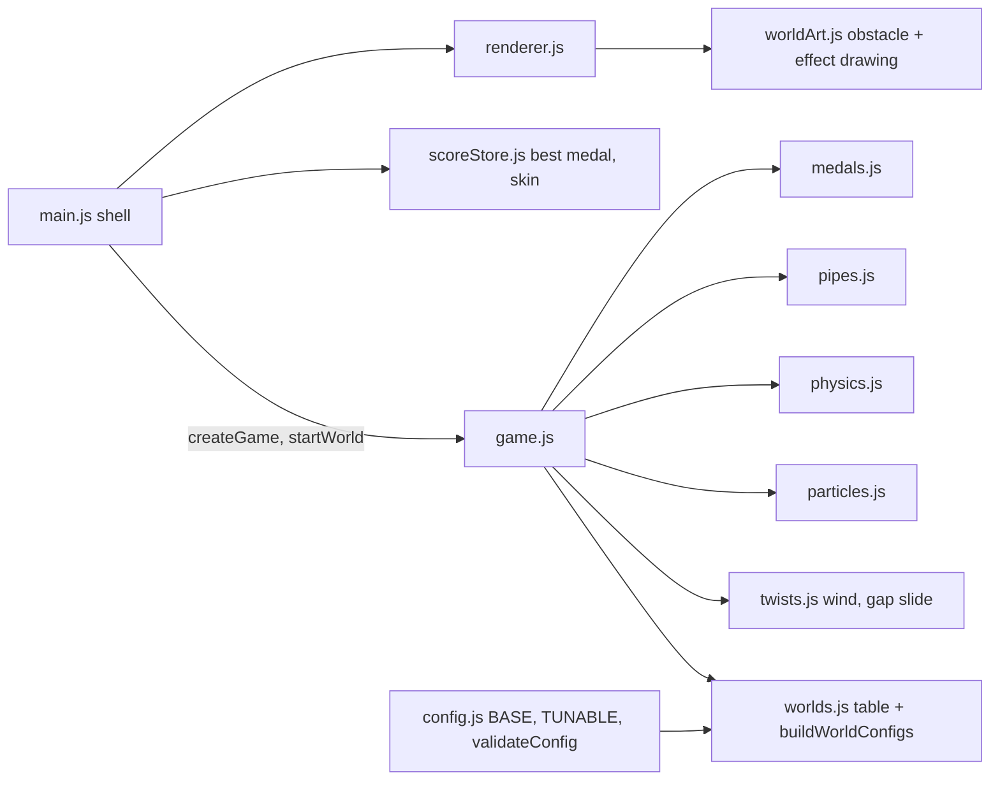
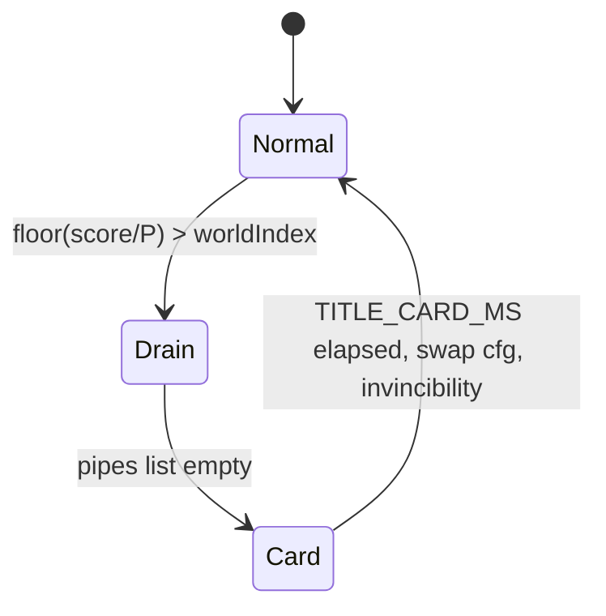

# Design Document: Ghosty's Journey

## Overview

Ghosty's Journey adds worlds, transitions, juice, medals and skins on top of the existing modules. It follows `coding-standards.md`: `game.js` owns the rules and returns events, helpers are pure, `main.js` owns storage and the loop, `renderer.js` only draws.

Approach: each world is a **numeric overlay** merged onto the base config, producing a frozen, validated **World_Config**. `state.cfg` is the active World_Config; `state.baseCfg` is the original. Overlays touch only ghost gravity/jump, speed and a new `twist` group, so `pipes.pipeRects` and collision stay identical in every world. Non-numeric world style (palette name, obstacle style) lives in a data table and is resolved by the renderer.

Correctness Properties are omitted on purpose. The user ruled out new property-based tests, and most of this feature is rendering and timing glue. Testing is example-based (see Testing Strategy).

## Architecture



Transition flow (mode stays `Playing`; the FSM gets no new mode):



### Decisions on open questions

**Left/Right keys.** `input.js` does not map them. Task 9 adds `ArrowLeft: 'left'` and `ArrowRight: 'right'` to `KEY_MAP`. The Main_Menu branch of `handleInput` cycles the skin on them when the High Scores panel is closed. `menu.js` gets two arrow button rects (`SKIN_PREV`, `SKIN_NEXT`) so pointer and touch users have the same control. Earlier tasks do not touch this.

**Per-world palettes.** `renderer.js` keeps one `PALETTE` export for shared colors (text, textOutline, highlight, dim) and gains `PALETTES = { sky, forest, castle, space }`, each with the same keys (`sky`, `cloud`, `pipe`, `pipeOutline`, `pipeLight`, `pipeDark`, `ground`, `groundStripe`, `accent`). The `sky` entry holds today's exact hex values, and `PALETTE` also spreads `PALETTES.sky` so existing imports and tests keep working. `activePalette(state)` returns `PALETTES[kind]` normally and `mixPalette(from, to, t)` during the title card. The mix runs only during the 1.5 s card (about nine hex values per frame), which is acceptable under the frame budget. Colors are still named entries in `renderer.js`; `worlds.js` refers to palettes by name only.

**Per-world speed vs `speedForScore`, `MAX_SPEED` and `reach.*`.** `speedForScore(cfg, localScore)` is unchanged. Playing now calls it with the active World_Config and `localScore = score - worldIndex × P`. A World_Config for kind `k` and loop `l` sets:
- `INITIAL_SPEED = base.INITIAL_SPEED × SPEED_SCALE[k] × LOOP_SPEED_FACTOR^l`, with `SPEED_SCALE = [1, 1.08, 1.17, 1.25]` (120, 130, 140, 150 px/s by default).
- `SPEED_STEP_INTERVAL = 1`, `SPEED_INCREMENT` unchanged, so the speed rises every point inside the world and resets at the next.
- `MAX_SPEED = min(base.MAX_SPEED, INITIAL_SPEED + WORLD_SPEED_SPAN)` with `WORLD_SPEED_SPAN = 30`. The span keeps the ramp meaningful whatever P is.

Each World_Config is validated on its own, so `speed.order` and `reach.*` use that world's `MAX_SPEED`. Loops are bounded: `buildWorldConfigs` raises the loop factor while all four kinds still validate, and stops at the last passing loop. With the default values Space (g 520, jump 240) climbs in about 1.39 s, so `PIPE_SPACING / MAX_SPEED` must stay above that and the cap should land at LOOP 3. After the cap, later loops reuse the capped speeds. The implementation task must print the actual cap.

**Space with weaker flap.** The overlay uses `GRAVITY_SCALE 0.65` and `JUMP_SCALE 0.8` (g 520, jump -240). Jump apex stays about 55 px, the same as Sky (56 px), so the same 3 flaps cover `MAX_GAP_SHIFT`, while the arc is longer in time (floaty). This passes `reach.fall` (0.78 s) and `reach.climb`. Scales apply to the URL-overridden base so `?gravity=` still works.

**Reach rules with twists.** `validateConfig` uses an effective shift `MAX_GAP_SHIFT + 2 × GAP_AMPLITUDE`, effective fall gravity `GRAVITY - WIND_FORCE` (an up-gust slows falling) and effective climb gravity `GRAVITY + WIND_FORCE` (a down-gust shortens each rise). With zero twists the results equal today's, so existing config tests are unaffected.

## Components and Interfaces

### config.js (extended)

New `BASE` entries:

```js
world:  { ..., POINTS_PER_WORLD: 5 },
timing: { ..., TITLE_CARD_MS: 1500, WORLD_INVINCIBILITY_MS: 1000 },
speed:  { ..., WORLD_SPEED_SPAN: 30, LOOP_SPEED_FACTOR: 1.1 },
twist:  { WIND_FORCE: 0, WIND_TELEGRAPH_MS: 1000, WIND_GUST_MS: 1500, WIND_CALM_MS: 2500,
          WIND_RAMP_MS: 400, GAP_AMPLITUDE: 0, GAP_PERIOD_S: 3 },
// added by later tasks:
fx:     { PUFF_COUNT: 5, PUFF_LIFE_MS: 350, BURST_COUNT: 24, POPUP_MS: 700, SHAKE_MS: 200, SHAKE_PX: 4, MAX_PARTICLES: 64 },
trail:  { LENGTH: 8, SAMPLE_MS: 40, SPACING_PX: 10 },
```

- `TUNABLE.pointsPerWorld = ['world', 'POINTS_PER_WORLD']`. Only this key is new in `TUNABLE`; the other additions are fixed constants.
- `validateConfig` rules: `world.pointsPerWorld` (integer >= 1), `timing.positive` extended to the two new durations, `speed.span` (`WORLD_SPEED_SPAN > 0`, `LOOP_SPEED_FACTOR >= 1`), `twist.windVsGravity` (`WIND_FORCE >= 0` and `< GRAVITY / 2`), `twist.amplitudeFits` (`2 × GAP_AMPLITUDE <= GAP_CENTER_MAX - GAP_CENTER_MIN`), `twist.gapFollow` (peak gap speed `<= JUMP_SPEED / 2`), and the adjusted `reach.*` rules.
- `parseOverrides` ignores the `world` param (handled by `worlds.parseStartWorld`) instead of warning "unknown parameter".
- `mergeWorld(cfg, overlay)` clones `cfg`, assigns overlay values, re-runs `derive`, deep-freezes and returns the result. `derive` reads only base keys, so it works on an already-built cfg.
- `loadConfig` also builds and validates all World_Configs at loop 0 and falls back to `DEFAULT_CONFIG` with a warning if any fails.

### worlds.js (new, pure data and functions)

```js
const WORLDS = [
  { id: 'sky',    title: 'THE SKY',    palette: 'sky',    obstacle: 'pipe',
    overlay: { gravityScale: 1,    jumpScale: 1,   speedScale: 1,    twist: {} } },
  { id: 'forest', title: 'THE FOREST', palette: 'forest', obstacle: 'trunk',
    overlay: { gravityScale: 1,    jumpScale: 1,   speedScale: 1.08, twist: { WIND_FORCE: 120 } } },
  { id: 'castle', title: 'THE CASTLE', palette: 'castle', obstacle: 'pillar',
    overlay: { gravityScale: 1,    jumpScale: 1,   speedScale: 1.17, twist: { GAP_AMPLITUDE: 24 } } },
  { id: 'space',  title: 'SPACE',      palette: 'space',  obstacle: 'asteroid',
    overlay: { gravityScale: 0.65, jumpScale: 0.8, speedScale: 1.25, twist: {} } },
];
```

Exports:
- `worldIndexFor(score, P)`, `worldKind(index)`, `loopOf(index)`, `startScoreFor(index, P)`.
- `parseStartWorld(search)` returns `{ index, warning }`.
- `buildWorldConfigs(cfg)` returns `{ configs, maxLoop }`, where `configs[loop * 4 + kind]` is a validated World_Config; `configFor(built, index)` clamps the loop to `maxLoop`.
- `titleFor(index)` returns `{ line1: 'WORLD n - THE NAME', line2: 'LOOP m' | null }`. An ASCII hyphen replaces the em dash because "Press Start 2P" may not contain that glyph.

Until task 6, overlays carry no speed fields (`speedScale` is unused and speed follows the global curve), so earlier tasks do not depend on later ones.

### game.js (extended)

New state fields: `baseCfg`, `worlds` (built configs), `worldIndex`, `startWorld` (null or index, set by the shell), `transition` (`null | { phase: 'drain' | 'card', cardMs, nextIndex }`), `wind`, `particles`, `shakeMs`, `trail`, `bestMedal`, `skin`.

- `startRound` sets score to `startScoreFor(startWorld ?? 0)`, `worldIndex`, `state.cfg = configFor(...)`, resets `transition`, `wind`, `particles`.
- `update` Playing order stays fixed; additions: (a) transition detection after scoring, (b) spawn gate `!state.transition`, (c) drain-to-card check, (d) card countdown and swap, (e) twist stepping, (f) `speed = speedForScore(cfg, score - worldIndex × P)` from task 6.
- At card end: `worldIndex = nextIndex`, `cfg` swapped (gravity and jump change, velocity kept), `invincibleMs = WORLD_INVINCIBILITY_MS`, event `{ type: 'worldEntered', index }`.
- If a pair scores while draining and pushes the score past the next threshold (small P), the next Transition starts right after the current one. This is acceptable and noted for P = 1.

### twists.js (new, pure)

- `stepWind(cfg, wind, dtMs, rng)` returns a new `{ phase: 'calm' | 'telegraph' | 'gust', timerMs, dir, force }`. Direction (+1 down, -1 up) is drawn from `rng` at the start of the telegraph. `force = dir × WIND_FORCE × smoothstep(ramp)` over `WIND_RAMP_MS` at both ends of the gust, so it is never a step. When `WIND_FORCE` is 0 it returns calm and the same object.
- `slideGaps(cfg, pairs, dtMs)` returns new pairs with `ageMs` advanced and `gapCenter = baseCenter + GAP_AMPLITUDE × sin(2π × ageMs / (GAP_PERIOD_S × 1000))`. Pairs without `baseCenter` pass through.
- `initPair(cfg, pair)` sets `baseCenter` (clamped to `[GAP_CENTER_MIN + A, GAP_CENTER_MAX - A]`) and `ageMs = 0`. The sine starts at 0, so a pair appears at its base center and the gap never leaves the legal range.
- `physics.stepGhost(cfg, ghost, dt, windAccel)` gets an optional fourth argument, default 0, added to gravity before the velocity update.
- `pipes.spawnPair` picks the previous center from `last.baseCenter ?? last.gapCenter`, so moving gaps do not skew the `MAX_GAP_SHIFT` rule.

### particles.js (new, pure)

`createParticles()`, `emitPuff(list, cfg, kind, x, y)`, `emitBurst(...)`, `emitPopup(list, x, y)`, `stepParticles(list, dtMs)`. A particle is `{ kind, x, y, vx, vy, ageMs, lifeMs, color }`. The list is capped at `fx.MAX_PARTICLES`. Randomness comes from an internal counter-based hash seeded from the list length and a counter in `state.fx`, never from the gameplay `rng`, so the pipe sequence in seeded tests is unchanged. `game.js` owns the list and steps it in Playing and Game_Over; the renderer only draws it.

### worldArt.js (new, draw-only)

Receives `ctx` and rectangles, no DOM access. `drawObstacle(ctx, style, rects, palette)` draws trunk, pillar or asteroid inside the four `pipeRects` (pre-rendered tiles cached per style, per `visual-design.md`). `drawBackdrop(ctx, kind, state)` draws leaves, torches and stars; `drawWindCue(ctx, state)` draws the arrow and the streaming leaves. Everything stays inside the collision rectangles.

### renderer.js (extended)

Draw order stays: sky, clouds/backdrop, obstacles, ground, ghost, UI. Added: `PALETTES`, `activePalette`, `mixPalette`, Title_Card overlay (fade alpha = triangle ramp over `TITLE_CARD_MS`, 25% in, 25% out), particles layer above obstacles, screen shake as a `ctx.translate` from `shakeMs` (deterministic sin offset, no rng), medal icons and trail.

### medals.js (new, pure)

`medalFor(score, P)` returns `null | 'bronze' | 'silver' | 'gold' | 'platinum'` using `floor(score / P)` capped at 4. `betterMedal(a, b)` and `MEDAL_ORDER`.

### scoreStore.js (extended) and skins.js (new)

- Keys `flappyKiro.bestMedal` and `flappyKiro.skin`. `loadBestMedal`, `recordBestMedal(storage, medal, stored)` (writes only when better), `loadSkin`, `saveSkin`. All use try/catch and read invalid values as none/`classic`.
- `skins.js`: `SKINS = [classic, pumpkin (bronze), rainbow (silver), gold (gold), starfield (platinum)]`, `isUnlocked(skin, bestMedal)`, `nextSkin(current, dir, bestMedal)` (cycles through all skins, locked ones are shown but not selectable).
- Renderer builds recolored sprite copies once through `opts.createCanvas` (like the white tint). Rainbow is a trail color style.

### input.js and menu.js

See "Left/Right keys" above. The main menu draws `< SKIN NAME >` with a lock label.

## Data Models

```js
// game state additions
{ baseCfg, worlds: { configs, maxLoop }, worldIndex: 0, startWorld: null,
  transition: null | { phase: 'drain' | 'card', cardMs: 0, nextIndex: 1 },
  wind: { phase: 'calm', timerMs: 0, dir: 1, force: 0 },
  particles: [], shakeMs: 0, trail: [], bestMedal: null, skin: 'classic' }
// pipe pair addition (Castle only): { x, gapCenter, scored, baseCenter, ageMs }
// events: { type: 'worldEntered', index }   (existing events unchanged)
```

## Error Handling

- Invalid `pointsPerWorld` or any invalid World_Config: warn and use `DEFAULT_CONFIG` (existing fallback path).
- Bad `?world=` value: warn, start in Sky.
- Storage read or write failures: caught, medal reads as none and skin as `classic`.
- Missing sprite when building skin copies: the skin falls back to the plain sprite without an error.
- A frame that throws still schedules the next one (existing behavior).

## Testing Strategy

Property-based testing does not apply here: the work is config data, timing and drawing, and the user excluded new property tests. Instead:

- **Existing suite:** run `npx vitest --run` after every task. The 52 test files must pass. The main risk is tests that play past score 5 and now trigger a Transition. Fix those in the test helper by building their cfg with a large `POINTS_PER_WORLD`, not by changing game rules.
- **Unit tests:** at most one small file per new module (`tests/unit/worlds.test.js`, `twists.test.js`, `particles.test.js`, `medals.test.js`, `skins.test.js`), a few examples each. `config`, `scoreStore` and `input` additions are added to the existing unit files, not new ones.
- **Headless check:** where useful, a temporary script in `scripts/` runs `createGame` and `update` with a seeded rng (for example, to print the loop cap and check transition timing), then is deleted.
- **Browser verification (user):** serve with `python3 -m http.server 8000`, open `http://localhost:8000/?world=forest&pointsPerWorld=3` and similar. Each task lists what to look for. The agent cannot drive a browser, so this step belongs to the user.
