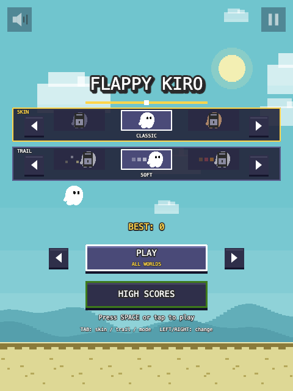
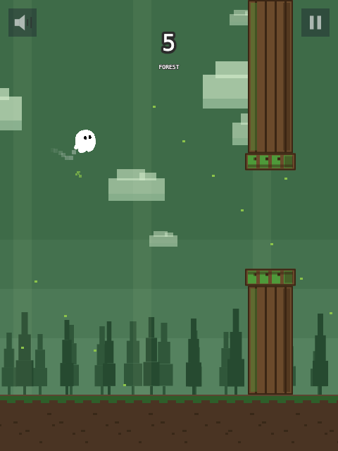
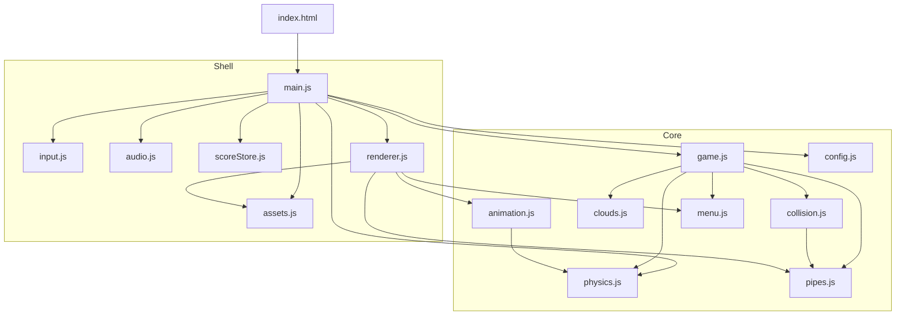
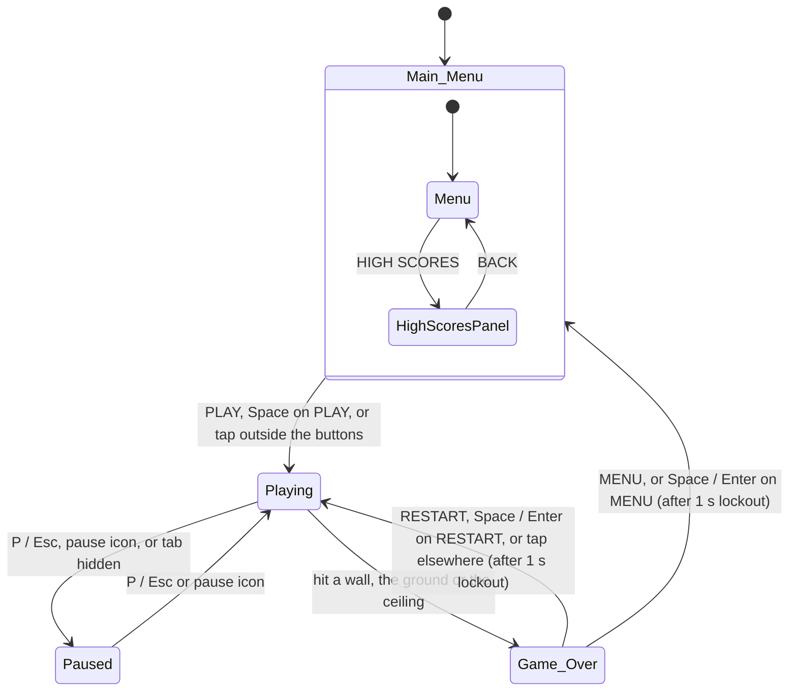
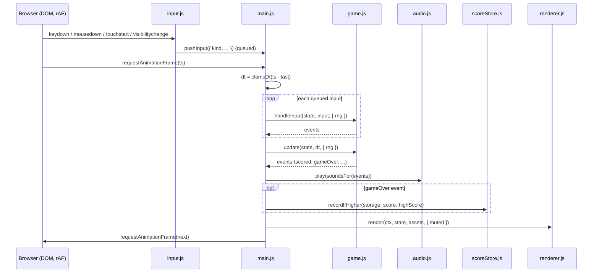
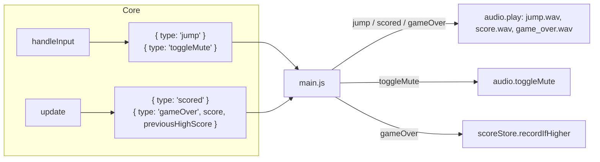
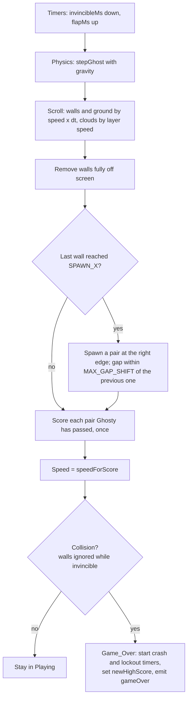
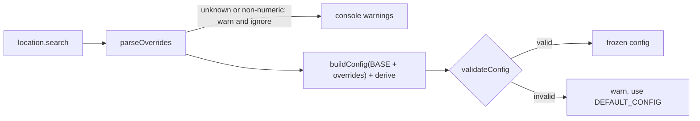
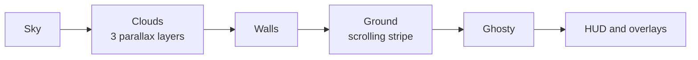

# Flappy Kiro

A Flappy Bird style browser game starring Ghosty, the Kiro ghost. Flap through the walls, score a point for each pair you pass, and travel through four worlds, each with its own look, music and twist.

**Play it live: https://williamcaronbastarache.com/flappy-kiro/**
**Watch the demo: https://youtu.be/_9Qb0pobL5M**

| Main menu | Forest world |
|---|---|
|  |  |

## For the judges

**Try it:** open the live game at https://williamcaronbastarache.com/flappy-kiro/, or serve the folder (`python3 -m http.server 8000`, then open http://localhost:8000) The live site is built and deployed by `.github/workflows/deploy.yml`. No install is needed to play. Space or a click flaps.

**What to look for**

- **Four worlds on one journey.** Sky, Forest, Castle and Space, switching after pair 5, 10 and 15 and then looping faster. Each world has its own backdrop, obstacles, palette, theme music and twist: Forest has telegraphed wind gusts (with a wind sound that swells with them), Castle has sliding gaps and Space has low gravity.
- **Two ways to play.** Use the arrows beside PLAY to choose ALL WORLDS or one world on its own. Single-world runs keep a separate best score for each world.
- **Music and sound.** Every theme, the wind, the score chime and the game over sound are generated by code (`mcp/audio/synth.js`); only the flap sound (`jump.wav`) is a recording. Run `npm run generate-audio` to rebuild the generated files.
- **Progression.** Medals follow how far a run gets. Your best medal unlocks skins and trails, which you pick in two rows that show the previous and next choice.
- **Polish.** Parallax scenery per world, shaded obstacles, particles, screen shake, and a leaderboard that shows the world and medal for each of the top 5 scores.
- **Resilient by design.** A missing image or sound falls back quietly, blocked audio or storage never interrupts a round, and a frame that throws still schedules the next one.

**How it was built with Kiro**

- **Specs:** the game started from requirements, a design and a task list in `.kiro/specs/flappy-kiro/`. The worlds feature has its own spec in `.kiro/specs/ghostys-journey/`.
- **Steering:** `.kiro/steering/` holds the coding standards, visual design rules and workspace rules that the agent followed throughout.
- **Hooks and agent:** `.kiro/hooks/` has a "Quality check" hook and an optional run-tests-on-save hook, and `.kiro/agents/code-reviewer.md` is a read-only reviewer for changes.
- **MCP servers:** `mcp/audio` renders sound presets and `mcp/leaderboard` serves scores and achievements. Both are configured in `.kiro/settings/mcp.json` (see [MCP servers](#mcp-servers)).

**Engineering:** a deterministic core (`src/game.js` and pure helpers) is separate from the browser shell (`src/main.js`), so the rules run under Node. Property-based tests (fast-check) and unit tests (vitest) cover physics, scoring, collision, worlds, audio, storage and rendering against a recording fake canvas. Run them with `npm install` then `npm test`. The game itself has no runtime dependencies and no build step.

Known limits: the pixel font "Press Start 2P" is not bundled, so a monospace fallback is used unless it is installed; audio needs a first click or key press because browsers block autoplay.

## Contents

- [Quick start](#quick-start)
- [How to play](#how-to-play)
- [Project layout](#project-layout)
- [Architecture](#architecture)
- [Game states](#game-states)
- [The frame loop](#the-frame-loop)
- [Inside `update`](#inside-update)
- [Configuration and tuning](#configuration-and-tuning)
- [Rendering](#rendering)
- [Assets and fallbacks](#assets-and-fallbacks)
- [Testing](#testing)
- [Ghosty's Journey](#ghostys-journey)
- [Deployment](#deployment)
- [MCP servers](#mcp-servers)
- [Contributing](#contributing)

## Quick start

The game is plain ES modules, so it has to be served over HTTP. Opening `index.html` from the file system (`file://`) won't load the modules.

```bash
python3 -m http.server 8000
# then open http://localhost:8000
```

Any static file server works (for example `npx serve`). The live version is deployed to GitHub Pages; see [Deployment](#deployment). Installing Node is only needed to run the tests:

```bash
npm install
npm test
```

## How to play

| Action | Keyboard | Mouse / touch |
|---|---|---|
| Flap (and start from the menu) | Space | Click or tap anywhere |
| Move between menu buttons | Up / Down | |
| Choose the skin, trail or play mode | Tab to pick the row, Left / Right to change | Click the arrows |
| Activate a menu button | Space or Enter | Click the button |
| Pause / resume | P or Escape | Pause icon (top right) |
| Mute / unmute | M | Speaker icon (top left) |
| Restart after game over | Space or Enter (RESTART is selected) | Click RESTART, or tap anywhere else |
| Back to the menu from game over | Down, then Space or Enter | Click MENU |

- Each round starts with 1.5 s of invincibility against walls, shown by Ghosty blinking. The ground and ceiling still count during this time.
- The scroll speed rises every 5 points, up to a maximum.
- After a crash, input is ignored for 1 s (`lockoutMs`). The Game Over panel appears 0.5 s in, so it stays readable for 0.5 s before input unlocks. `lockoutMs` must be greater than `crashMs`.
- Switching tabs pauses the game.
- Your best score and your top 5 scores are kept in `localStorage`. The High Scores panel and the Game Over panel show the top 5.
- Each screen has its own looping theme: a bouncy menu tune, a breezy Sky theme, a folk Forest theme (with wind that swells with the gusts), a Castle march and a slow synth groove in Space. Music pauses with the game and stops at game over. Mute (M) silences music too.

## Project layout

```
index.html            page shell; loads src/main.js as a module
src/
  main.js             browser shell: loop, wiring, audio, storage, resize
  game.js             game state machine: createGame, startRound, handleInput, update
  config.js           base values, derived values, URL overrides, validation
  physics.js          gravity, jump, tilt, frame time clamp
  pipes.js            wall spawning, movement, speed curve, rectangles
  collision.js        circle-vs-rectangle, ground and ceiling tests
  clouds.js           parallax clouds: create, move, wrap
  animation.js        Ghosty frame selection (idle, flap, death)
  menu.js             menu model, button and icon layout, hit testing
  scoreStore.js       high score, top 5, per-world bests, skin, trail and mode persistence
  worlds.js           worlds, play modes, per-world configs and loops
  twists.js           Forest wind and Castle moving gaps
  worldArt.js         per-world obstacles, backdrops and the wind cue
  skins.js            skins and trails, unlocked by medals
  medals.js           medals from how far a run got
  particles.js        puffs, bursts and score popups
  audio.js            audio player with mute, event-to-sound mapping
  assets.js           independent image and sound loading with fallbacks
  input.js            keyboard, mouse, touch and visibility wiring
  renderer.js         all canvas drawing
assets/               ghosty.png, jump.wav, score.wav, game_over.wav, music-menu.wav, music-sky.wav, music-forest.wav, music-castle.wav, music-space.wav, wind.wav
mcp/                  local MCP servers: audio (sound generation) and leaderboard
scripts/              generate-audio.js (builds the score and game over sounds, the wind and the music loops)
tests/
  helpers/            shared fast-check generators and a game runner
  props/              property-based tests, one per design property (pNN-*.test.js)
  unit/               unit tests per module
.kiro/
  specs/flappy-kiro/  requirements, design and task list
  steering/           coding standards, visual design and workspace rules
ghosty-sprites.md     sprite and animation spec
ui-mockups.md         screen layouts and palette
audio-assets.md       sound design notes
```

## Architecture

The code is split into a **deterministic core** and a thin **browser shell**.

- **Core** (`game.js` and the helper modules): owns all game rules. It never touches the DOM, time or randomness directly. Time comes in as `dt`, randomness as `{ rng }`, and effects go out as events.
- **Shell** (`main.js`): owns the browser. It runs the `requestAnimationFrame` loop and turns events into sounds and storage writes. It also loads assets and draws through the renderer.

### Module dependencies

Arrows point from a module to the modules it imports.



Two places share data on purpose, so that what you see matches what happens:

- **Walls:** `collision.js` and `renderer.js` both use `pipes.pipeRects`. The walls you see are the walls you hit.
- **Controls:** `renderer.js` and `game.js` (via `menu.hitTest`) both use the rectangles from `menu.js`. The buttons you see are the buttons you click.

### Responsibilities

| Module | Pure? | Responsibility |
|---|---|---|
| `config.js` | yes | Base values, `derive`, URL overrides (`parseOverrides`, `loadConfig`), `validateConfig` |
| `physics.js` | yes | `stepGhost` (semi-implicit Euler), `applyJump`, `tiltFor`, `clampDt` |
| `pipes.js` | yes | Gap placement, `shouldSpawn`/`spawnPair`, `movePairs`, `removeOffscreen`, `speedForScore`, `pipeRects` |
| `collision.js` | yes | Strict circle-vs-rectangle test, ground and ceiling, `detect` |
| `clouds.js` | yes | `createClouds`, `moveClouds` with wrap-around |
| `animation.js` | yes | Picks the idle, flap or death frame and its transforms |
| `menu.js` | yes | Menu navigation, button and icon rectangles, `hitTest` |
| `game.js` | mutates state | Modes, input routing, the per-frame `update`, events |
| `scoreStore.js` | storage | Reads and writes the high score and top 5 list, never throws |
| `audio.js` | audio elements | Plays sounds, mute, `soundsFor(events)` |
| `assets.js` | browser | Loads each asset independently; failures resolve to `null` |
| `input.js` | browser | Maps DOM events to inputs such as `{ kind: 'space' }` or `{ kind: 'pointer', x, y }` |
| `renderer.js` | canvas | Draws everything from the state, reads nothing back |
| `main.js` | browser | Startup, the loop, event handling, resize |

## Game states

`game.js` is a finite state machine with four modes. Game Over can go back to Playing or to Main_Menu. The High Scores panel is part of `Main_Menu`; opening it does not change the mode.



Every way into `Playing` goes through `startRound`. It resets the round, starts invincibility and applies the first jump.

## The frame loop

`main.js` runs one loop with a fixed order each frame. Input is queued by the DOM listeners and drained once per frame, so it is handled at a predictable point.



Notes:

- `dt` is clamped (50 ms by default), so a slow frame can't tunnel Ghosty through a wall.
- The frame clock resets when the tab becomes visible again, so there's no jump after a background tab.
- The next frame is scheduled even if a frame throws, so one bad frame can't freeze the game.

### Events

The core never plays sounds or writes storage. It returns events, and the shell acts on them.



## Inside `update`

While `Playing`, each frame follows this pipeline. In the other modes the world is frozen:
- `Main_Menu` only advances the idle animation.
- `Paused` changes nothing.
- `Game_Over` runs the crash animation (Ghosty falls to the ground) and the restart lockout.



## Configuration and tuning

All values live in `src/config.js`:

- **`BASE`:** world size, physics, wall sizes, speed curve, timings, cloud layers, UI layout and animation tables.
- **`derive`:** computes dependent values such as `GROUND_TOP`, the gap centre range, `SPAWN_X` and the cloud layer speeds.

The final config is frozen, and every module reads from it. There are no magic numbers in the logic.

You can tune the whitelisted values from the URL without editing code:

```
http://localhost:8000/?gravity=1000&gapHeight=170&wallSpeed=140
```

Tunable names: `gravity`, `jumpVelocity`, `hitboxRadius`, `gapHeight`, `gapMargin`, `pipeSpacing`, `maxGapShift`, `wallSpeed`, `speedIncrement`, `speedStepInterval`, `maxSpeed`, `invincibilityMs`, `crashMs`, `lockoutMs`, `cloudSpeedMin`, `cloudSpeedMax`.



Validation only checks rules a tunable value can break, for example:
- The gap must be taller than Ghosty's hitbox and must fit above the ground.
- `GAP_MARGIN >= CAP_HEIGHT`.
- Gaps must stay reachable at maximum speed.
- Clouds must be slower than the walls.

A bad URL can never produce an unplayable game.

Default values include gravity 800 px/s², jump velocity -300 px/s, wall speed 120 rising to 240 px/s, a 140 px gap and 350 px between walls.

## Rendering

`renderer.js` draws the whole frame from the state on a fixed 480 x 640 logical canvas. CSS scales the canvas to the window with `image-rendering: pixelated`.

Draw order, back to front:



- **Ghosty:** `animation.currentFrame` picks the idle bob, the flap squash and stretch, or the death spin and flash. The renderer applies the frame's offset, scale, rotation and tint. Rotation follows vertical speed.
- **Parallax:** three cloud layers move at 15, 35 and 55 px/s. Nearer clouds are wider, faster and more opaque. Walls and ground move together at the game speed.
- **HUD and overlays:**
  - The score shows at the top while playing.
  - The mute and pause icons appear in Playing and Paused.
  - Paused dims the screen.
  - Game Over shows a panel with the score, the best score, "NEW BEST!", a TOP 5 list, and RESTART and MENU buttons after the crash animation.

See `.kiro/steering/visual-design.md`, `ghosty-sprites.md` and `ui-mockups.md` for the visual rules.

## Assets and fallbacks

Each asset loads on its own. One failure never blocks the game or the other assets.

| Asset | If it fails to load |
|---|---|
| `assets/ghosty.png` | A 24 x 24 white square is drawn in its place |
| `assets/ghosty-sheet.png` (optional sprite sheet) | Transforms of `ghosty.png` are used. This is expected today, since the sheet doesn't exist yet |
| `jump.wav`, `score.wav`, `game_over.wav` | That sound is silent |
| `music-*.wav` (menu, sky, forest, castle, space) | No music for that screen or world; the game is otherwise unaffected |
| `wind.wav` | No forest wind; the game is otherwise unaffected |
| `localStorage` | The high score reads as 0 and isn't saved |

`assets/score.wav` is generated:

```bash
npm run generate-audio
```

## Testing

```bash
npm test                                   # whole suite
npx vitest --run tests/props/p13-scoring.test.js   # one file
```

- **Property tests** (`tests/props/pNN-*.test.js`): each one checks a numbered correctness property from `.kiro/specs/flappy-kiro/design.md` over many generated configs, states and input sequences. Examples:
  - The world is frozen outside Playing.
  - Each pair scores exactly once.
  - Every mode change is a permitted transition.
  - The circle-vs-rectangle test is strict.
- **Unit tests** (`tests/unit/`): config defaults and overrides, audio, asset fallbacks, input wiring, the renderer (against a recording fake canvas) and the generated WAV.
- **Helpers:**
  - `tests/helpers/arbitraries.js` has generators for configs, ghosts, pipes, `dt` and storage.
  - `tests/helpers/game-arbs.js` has game-state generators and `runSteps`, which drives `handleInput` and `update` and records transitions and events.

The core is deterministic (seeded `rng`, explicit `dt`), so tests run the real game logic with no browser and no timers.

## Ghosty's Journey

Every `pointsPerWorld` points (default 5) the run moves to the next world, with a title card, a palette crossfade and 1 s of invincibility:

| World | Twist |
|---|---|
| Sky | Classic pipes |
| Forest | Wind gusts, telegraphed ~1 s ahead by an arrow and streaming leaves |
| Castle | Gaps slide slowly up and down |
| Space | Lower gravity and a weaker flap |

After Space the journey loops (LOOP 2, LOOP 3, ...), about 10% faster each time. Each world starts a little faster than the last and ramps up inside the world.

- **Medals** on the game-over panel: Bronze, Silver, Gold and Platinum at 1, 2, 3 and 4 × `pointsPerWorld`.
- **Play modes:** the arrows beside PLAY (or Tab to the mode, then Left/Right) choose ALL WORLDS, the journey through every world, or one world on its own (SKY ONLY, FOREST ONLY, CASTLE ONLY, SPACE ONLY). A single-world run starts at 0, never changes world and keeps its own best per world; medals and the top 5 count journey runs only.
- **Skins and trails** are two rows on the main menu, each showing the previous, current and next choice. Click an arrow, or press Tab to pick the row and Left/Right to change it. They unlock with your best medal. Skins: Pumpkin (Bronze), Gold (Gold), Starfield (Platinum). Trails: Ember (Bronze), Rainbow (Silver), Stardust (Gold).
- **Testing and recording:** `?world=sky|forest|castle|space` starts a round in that world (the score starts at its threshold), and `?pointsPerWorld=2` makes worlds short. Example: `http://localhost:8000/?world=forest&pointsPerWorld=3`.

World logic lives in `src/worlds.js` (table, per-world configs, loops), `src/twists.js` (wind, moving gaps), `src/particles.js`, `src/medals.js`, `src/skins.js` and `src/worldArt.js` (per-world drawing). The spec is in `.kiro/specs/ghostys-journey/`.
## Deployment

The game is hosted for free on GitHub Pages. `.github/workflows/deploy.yml` runs on every push to `master`:

1. `npm ci` and `npm test`. A failing test stops the deploy.
2. `npm run build`: `scripts/build-site.js` copies only `index.html`, `src/`, `assets/` and the licence into `_site/`, which comes to about 2 MB.
3. The `_site/` artifact is uploaded and deployed to Pages.

**One-time setup:** in **Settings > Pages**, set **Source** to **GitHub Actions**. Pages is free for public repositories.

**Analytics (optional):** add one or both repository variables under **Settings > Secrets and variables > Actions > Variables**. With neither set, the site ships with no analytics.

| Variable | Adds |
|---|---|
| `CF_ANALYTICS_TOKEN` | [Cloudflare Web Analytics](https://www.cloudflare.com/web-analytics/) (free, no cookies) |
| `GOATCOUNTER_CODE` | [GoatCounter](https://www.goatcounter.com/) (free for non-commercial use) |

The build validates both values and adds the snippet before `</head>`.

**Monitoring:** `.github/workflows/uptime.yml` checks the page, `src/main.js` and two assets every hour. A failed check sends GitHub's failed-workflow email. Set a `SITE_URL` variable if the site moves. GitHub pauses scheduled workflows after 60 days with no repository activity.

## MCP servers

Two local MCP servers in `mcp/` are registered in `.kiro/settings/mcp.json`. Both are dependency-free and share the stdio transport in `mcp/lib/stdio-server.js`. They are tools for Kiro and other MCP clients; the browser game does not call them.

| Server | Tools | Data |
|---|---|---|
| `flappy-audio` (`mcp/audio/server.js`) | `list_presets`, `generate_sound` (`flap`, `score`, `hit`, `wind`, `music_menu`, `music_sky`, `music_forest`, `music_castle`, `music_space`, optional `seed` and `file`) | Writes WAVs to `assets/generated/` (gitignored), or `AUDIO_OUT_DIR` inside the project |
| `flappy-leaderboard` (`mcp/leaderboard/server.js`) | `submit_score`, `get_leaderboard`, `get_player`, `list_achievements` | `data/leaderboard.json` (gitignored), or `LEADERBOARD_FILE` |

The audio presets are synthesised in `mcp/audio/synth.js`. The same code builds the game's generated sounds:

```bash
npm run generate-audio   # writes assets/score.wav, assets/wind.wav and the five assets/music-*.wav themes
```

## Contributing

- Follow `.kiro/steering/coding-standards.md`: ES modules only, no globals, a pure core, events instead of effects, and one source of truth for shared geometry.
- Put any new tunable in `config.js`: add it to `BASE`, add a `TUNABLE` entry if it should be URL-tunable, and add a validation rule for anything it can break.
- Add or update a test with every behaviour change, and run `npm test` before committing.
- Keep temporary scripts in `scripts/` and delete them when done.

The full product spec lives in `.kiro/specs/flappy-kiro/` (requirements, design and tasks).

## Licence

See [LICENCE.md](LICENCE.md).
